<a id="top"></a>

<div align="center">


# SIEM Salabim — Dashboard SIEM Wazuh untuk SOC

**Pantau alert. Selidiki keterkaitan. Dokumentasikan respons.**

Dashboard SIEM untuk monitoring alert Wazuh, investigasi insiden keamanan, triage, analisis AI, dan notifikasi Telegram.

[Tentang aplikasi](#tentang) · [Cakupan](#cakupan) · [Untuk siapa](#pengguna) · [Galeri](#galeri) · [Fitur](#fitur) · [Keamanan](#keamanan) · [Instalasi](#instalasi) · [Perubahan 1.2](docs/README.md) · [Kontribusi](#kontribusi)

<p>
  
  
  
  
</p>

</div>

<a id="tentang"></a>

## Tentang SIEM Salabim

**SIEM Salabim adalah aplikasi dashboard Security Information and Event Management (SIEM) dan ruang kerja Security Operations Center (SOC)** untuk membantu tim keamanan memantau alert, menyelidiki kejadian, membagi tanggung jawab penanganan, dan mendokumentasikan tindak lanjut. Aplikasi berbasis Laravel ini dapat dijalankan pada server sendiri (*self-hosted*) dan terhubung ke **Wazuh Indexer atau OpenSearch**.

Alert dikumpulkan dari indeks Wazuh lalu disimpan pada database aplikasi. Analis dapat membuka bukti JSON/tabel, menghubungkan beberapa alert dalam satu investigasi, meminta analisis AI, melakukan ACK atau ignore dengan alasan, serta mengirim hasil pemeriksaan melalui Telegram. Dashboard dan riwayat membantu tim menelusuri kondisi monitoring keamanan dan pekerjaan yang sudah dilakukan.

Deteksi awal dan pengumpulan log dilakukan oleh Wazuh. Cakupan SIEM Salabim adalah pengelolaan alert setelah tersedia di indexer, sampai pencatatan tindakan dan komunikasi temuan. Keputusan insiden serta tindakan pada endpoint, firewall, atau akun terkait tetap dilakukan dan divalidasi oleh operator. Hasil AI merupakan bahan pendukung investigasi.

<a id="cakupan"></a>

## Tujuan dan cakupan penggunaan

| Kebutuhan | Penggunaan SIEM Salabim |
| :--- | :--- |
| **Monitoring keamanan harian** | Meninjau dashboard SOC, alert terbaru, severity, tren, dan pola MITRE yang tersedia dari evidence. |
| **Investigasi dan triage alert** | Memeriksa log asli, mengurutkan kronologi, menganalisis satu atau beberapa alert, lalu menentukan tindak lanjut. |
| **Pembagian pekerjaan analis** | Menetapkan pemilik melalui ACK pertama dan membatasi ignore/notifikasi kepada pemilik tersebut. |
| **Komunikasi temuan keamanan** | Menyusun pesan Telegram dari template atau pesan bebas; mengirim ringkasan massal sesuai tujuan agent. |
| **Audit dan evaluasi operasi SOC** | Menelusuri Log analis, Log aktivitas administrasi, serta statistik penanganan pada leaderboard. |
| **Administrasi dan retensi** | Mengatur akses, integrasi, template, backup JSON/SQL, serta penghapusan data dari backup yang terverifikasi. |

Satu instalasi dapat melayani beberapa tim atau organisasi dengan pembatasan akses **per identitas agent**. Analis hanya melihat agent yang diizinkan pada dashboard, detail, riwayat, API, dan analisis AI. Konfigurasi sistem tetap dikelola admin pada tingkat instalasi; kebutuhan pemisahan infrastruktur dan database antarorganisasi perlu disesuaikan dengan kebijakan masing-masing.

<a id="pengguna"></a>

## Pengguna yang dituju

- **Analis SOC dan tim CSIRT:** memantau alert Wazuh, mengumpulkan konteks investigasi, mencatat hasil validasi, dan mengomunikasikan temuan.
- **Administrator keamanan dan pengelola TI:** mengatur integrasi SIEM, akun, privilege, cakupan agent, serta retensi data.
- **Koordinator atau pengelola layanan SOC:** membagi cakupan pemantauan antaranggota, meninjau kepemilikan penanganan, dan mengevaluasi pekerjaan tim.
- **Pengajar, mahasiswa, dan peserta laboratorium keamanan:** berlatih monitoring log, pembacaan evidence, dan alur triage menggunakan lingkungan uji serta data yang diizinkan.

Untuk memantau kejadian keamanan nyata, siapkan Wazuh/Indexer yang dapat diakses dan menghasilkan alert. Integrasi AI serta Telegram dapat ditambahkan sesuai kebutuhan operasional.

**Pembaruan versi 1.2:** kepemilikan ACK, keamanan sesi, penonaktifan akun, enkripsi payload, routing Agent ID, editor notifikasi tunggal/massal, dan pengelolaan template. Lihat [catatan lengkap perubahan SIEM Salabim 1.1 → 1.2](docs/README.md).

<a id="demo"></a>
<a id="galeri"></a>

## Galeri aplikasi

Jelajahi **49 Tampilan Aplikasi** sesuai alur penggunaan: masuk, monitoring, investigasi, tindak lanjut, lalu administrasi. Setiap gambar ditampilkan satu kolom selebar area baca, dilengkapi nama halaman dan kegunaannya. Klik gambar untuk membuka PNG asli dan memperbesar detail; gunakan **Sebelumnya / Berikutnya** untuk berpindah antarpreview.

Contoh admin mencakup seluruh agent, sedangkan contoh analis hanya satu agent dengan privilege yang ditentukan admin. Perbedaan angka, menu, dan hasil analisis mengikuti hak akses akun.

| Preview | Bagian aplikasi | Yang dapat dipahami |
| :--- | :--- | :--- |
| 01–02 | [Masuk ke aplikasi](#preview-login) | Mengenali pintu masuk aplikasi dan pilihan tema sebelum mulai bekerja. |
| 03–10 | [Dashboard, ringkasan AI, dan pilihan tema](#preview-dashboard) | Memahami kondisi SOC, prioritas penanganan, grafik, dan perbedaan cakupan admin serta analis. |
| 11–18 | [Monitoring dan investigasi satu alert](#preview-investigasi) | Menemukan alert, memeriksa bukti asli, lalu membaca hasil analisis sebelum mengambil tindakan. |
| 19–24 | [Triage massal, kronologi, dan notifikasi](#preview-triage) | Meninjau hubungan beberapa alert dan memeriksa pesan sebelum mengomunikasikan temuan. |
| 25–31 | [Riwayat, kinerja SOC, dan audit](#preview-riwayat) | Menelusuri penanganan alert, mengevaluasi pekerjaan SOC, dan memeriksa aktivitas administrasi. |
| 32–39 | [Settings dan integrasi](#preview-settings) | Menghubungkan sumber alert, mengatur analisis dan notifikasi, serta mengelola data aplikasi. |
| 40–43 | [Manajemen pengguna dan pembatasan akses](#preview-akses) | Membuat akun, menentukan agent yang boleh dilihat, dan mengatur hak tindakan setiap pengguna. |
| 44–49 | [Profil dan keamanan akun](#preview-akun) | Memperbarui identitas, mengganti kata sandi, dan mengenali halaman konfirmasi serta verifikasi email. |

[Mulai dari preview 01 →](#preview-01) · [Langsung ke fitur](#fitur) · [Langsung ke instalasi](#instalasi)

<a id="preview-login"></a>
<details>
<summary><strong>1. Masuk ke aplikasi</strong></summary>

Mengenali pintu masuk aplikasi dan pilihan tema sebelum mulai bekerja.

<a id="preview-01"></a>

#### 01 / 49 — Login dalam mode gelap

**Bagian:** Login · **Akses:** Admin dan analis · **Halaman:** `/login`.

**Untuk apa:** Halaman masuk dengan email dan kata sandi akun SOC. Tema gelap memberi gambaran tampilan awal aplikasi sebelum pengguna membuka dashboard.

[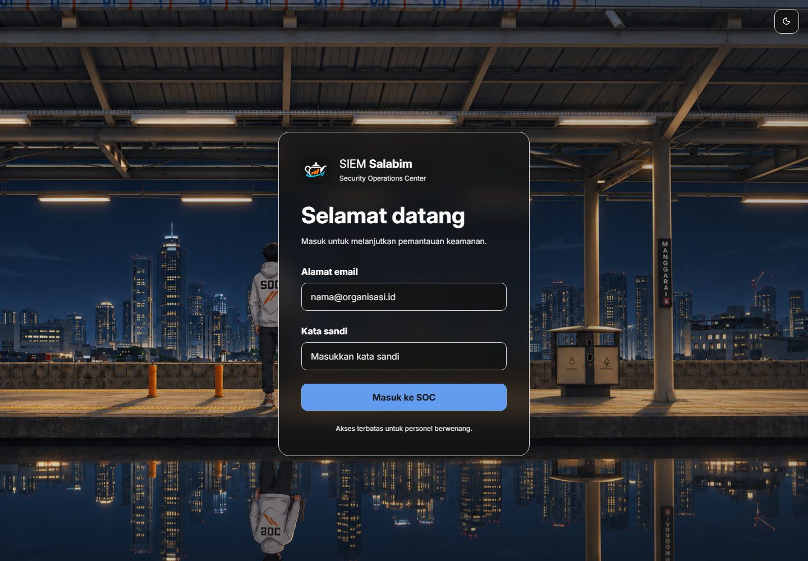](docs/asset/login-dark.png)

[Daftar bagian](#galeri) · [Berikutnya →](#preview-02)

---

<a id="preview-02"></a>

#### 02 / 49 — Login dalam mode terang

**Bagian:** Login · **Akses:** Admin dan analis · **Halaman:** `/login`.

**Untuk apa:** Formulir masuk yang sama dalam tema terang. Pengguna dapat memilih tampilan yang sesuai dengan kondisi pencahayaan dan kenyamanan membaca.

[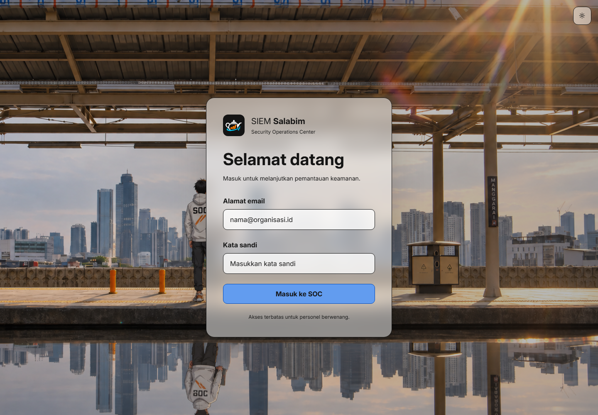](docs/asset/login-light.png)

[← Sebelumnya](#preview-01) · [Daftar bagian](#galeri) · [Berikutnya →](#preview-03)
</details>
---

<a id="preview-dashboard"></a>
<details>
<summary><strong>2. Dashboard, ringkasan AI, dan pilihan tema</strong></summary>

Memahami kondisi SOC, prioritas penanganan, grafik, dan perbedaan cakupan admin serta analis.

<a id="preview-03"></a>

#### 03 / 49 — Dashboard SOC untuk admin

**Bagian:** Monitoring → Dashboard · **Akses:** Admin · **Halaman:** `/dashboard`.

**Untuk apa:** Ringkasan operasional seluruh agent: jumlah alert, status tindak lanjut, prioritas high/critical, tren harian, dan pola MITRE. Admin memakai halaman ini untuk menentukan fokus pemantauan.

[](docs/asset/admin-dashboard.png)

[← Sebelumnya](#preview-02) · [Daftar bagian](#galeri) · [Berikutnya →](#preview-04)

---

<a id="preview-04"></a>

#### 04 / 49 — Dashboard SOC untuk analis

**Bagian:** Monitoring → Dashboard · **Akses:** Analis · **Halaman:** `/dashboard`.

**Untuk apa:** Ringkasan monitoring yang mengikuti agent yang diizinkan untuk akun analis. Pada contoh ini analis mendapat satu agent, sehingga angka dan hasil yang terlihat dapat berbeda dari admin.

[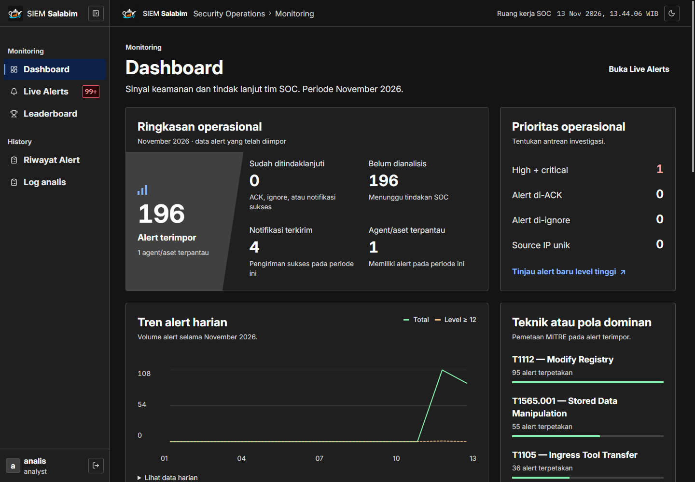](docs/asset/analis-dashboard.png)

[← Sebelumnya](#preview-03) · [Daftar bagian](#galeri) · [Berikutnya →](#preview-05)

---

<a id="preview-05"></a>

#### 05 / 49 — Dashboard admin secara lengkap

**Bagian:** Monitoring → Dashboard · **Akses:** Admin · **Halaman:** `/dashboard`.

**Untuk apa:** Tangkapan seluruh tinggi dashboard, termasuk grafik dan ringkasan di bagian bawah halaman. Preview ini memperlihatkan susunan informasi dari gambaran umum hingga kesimpulan investigasi.

[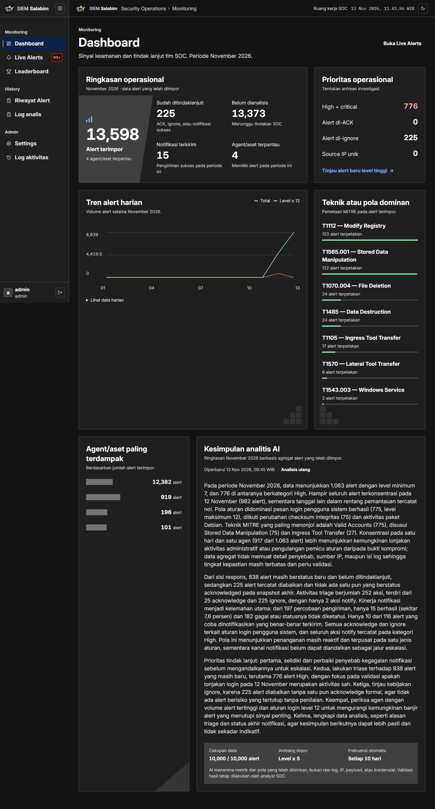](docs/asset/admin-dashboard-full.png)

[← Sebelumnya](#preview-04) · [Daftar bagian](#galeri) · [Berikutnya →](#preview-06)

---

<a id="preview-06"></a>

#### 06 / 49 — Dashboard analis secara lengkap

**Bagian:** Monitoring → Dashboard · **Akses:** Analis · **Halaman:** `/dashboard`.

**Untuk apa:** Seluruh bagian dashboard analis dalam satu gambar panjang. Gunakan preview ini untuk memahami informasi yang tersedia bagi operator dengan cakupan agent terbatas.

[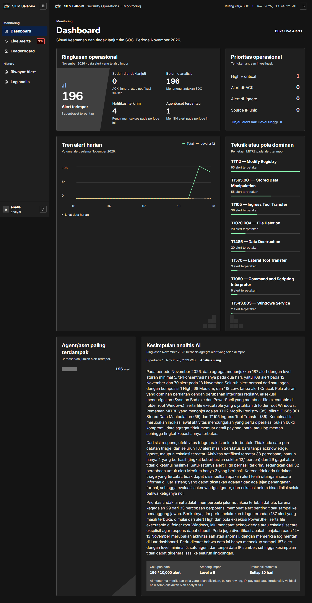](docs/asset/analis-dashboard-full.png)

[← Sebelumnya](#preview-05) · [Daftar bagian](#galeri) · [Berikutnya →](#preview-07)

---

<a id="preview-07"></a>

#### 07 / 49 — Kesimpulan AI pada dashboard admin

**Bagian:** Monitoring → Dashboard · **Akses:** Admin · **Halaman:** `/dashboard`.

**Untuk apa:** Panel hasil analisis AI tersimpan yang merangkum pola alert, keterbatasan bukti, dan prioritas tindak lanjut. Admin dapat memakainya sebagai titik awal investigasi, lalu memvalidasi kesimpulan terhadap bukti.

[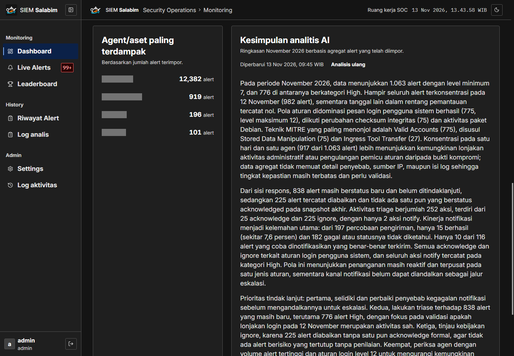](docs/asset/admin-dashboard-ai.png)

[← Sebelumnya](#preview-06) · [Daftar bagian](#galeri) · [Berikutnya →](#preview-08)

---

<a id="preview-08"></a>

#### 08 / 49 — Kesimpulan AI pada dashboard analis

**Bagian:** Monitoring → Dashboard · **Akses:** Analis · **Halaman:** `/dashboard`.

**Untuk apa:** Ringkasan AI untuk data dalam cakupan agent akun analis. Panel membantu menentukan hal yang perlu diperiksa tanpa memperluas akses ke agent lain.

[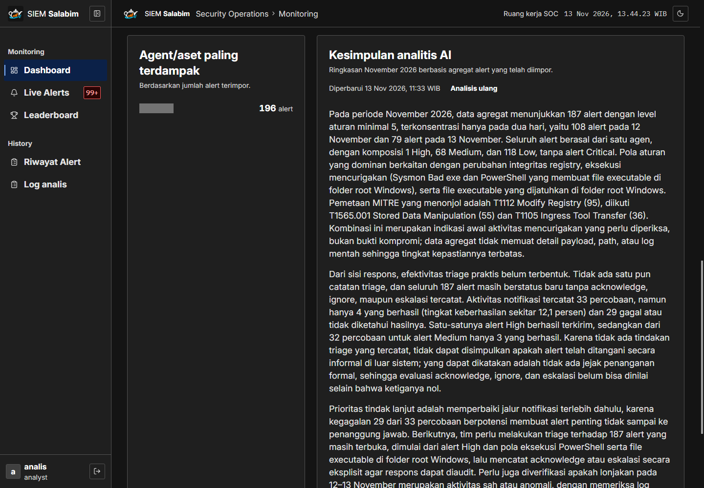](docs/asset/analis-dashboard-ai.png)

[← Sebelumnya](#preview-07) · [Daftar bagian](#galeri) · [Berikutnya →](#preview-09)

---

<a id="preview-09"></a>

#### 09 / 49 — Dashboard admin dalam mode terang

**Bagian:** Monitoring → Dashboard · **Akses:** Admin · **Halaman:** `/dashboard`.

**Untuk apa:** Alternatif tema terang untuk dashboard admin. Informasi monitoring dan fungsi tetap sama, dengan warna antarmuka yang disesuaikan untuk kenyamanan membaca.

[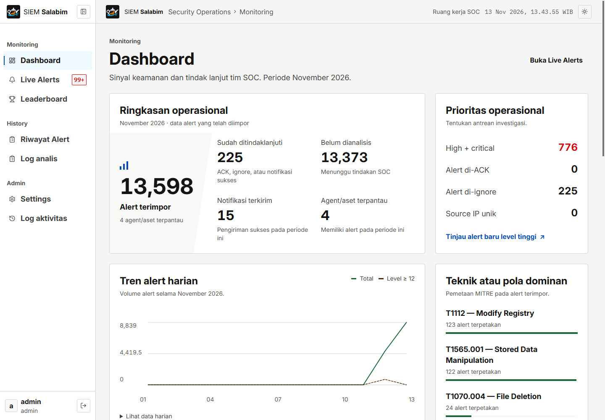](docs/asset/admin-dashboard-light.png)

[← Sebelumnya](#preview-08) · [Daftar bagian](#galeri) · [Berikutnya →](#preview-10)

---

<a id="preview-10"></a>

#### 10 / 49 — Dashboard analis dalam mode terang

**Bagian:** Monitoring → Dashboard · **Akses:** Analis · **Halaman:** `/dashboard`.

**Untuk apa:** Tampilan terang dashboard analis. Pembatasan agent dan privilege akun tetap berlaku saat tema diganti.

[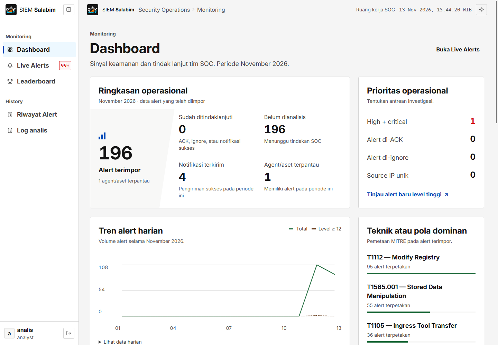](docs/asset/analis-dashboard-light.png)

[← Sebelumnya](#preview-09) · [Daftar bagian](#galeri) · [Berikutnya →](#preview-11)
</details>
---

<a id="preview-investigasi"></a>
<details>
<summary><strong>3. Monitoring dan investigasi satu alert</strong></summary>

Menemukan alert, memeriksa bukti asli, lalu membaca hasil analisis sebelum mengambil tindakan.

<a id="preview-11"></a>

#### 11 / 49 — Daftar Live Alerts untuk admin

**Bagian:** Monitoring → Live Alerts → Detail alert · **Akses:** Admin · **Halaman:** `/live-alerts`.

**Untuk apa:** Pusat pemantauan alert seluruh agent dengan pencarian dan filter agent, level, status, serta tanggal. Admin dapat membuka detail atau memilih beberapa alert untuk ditinjau bersama.

[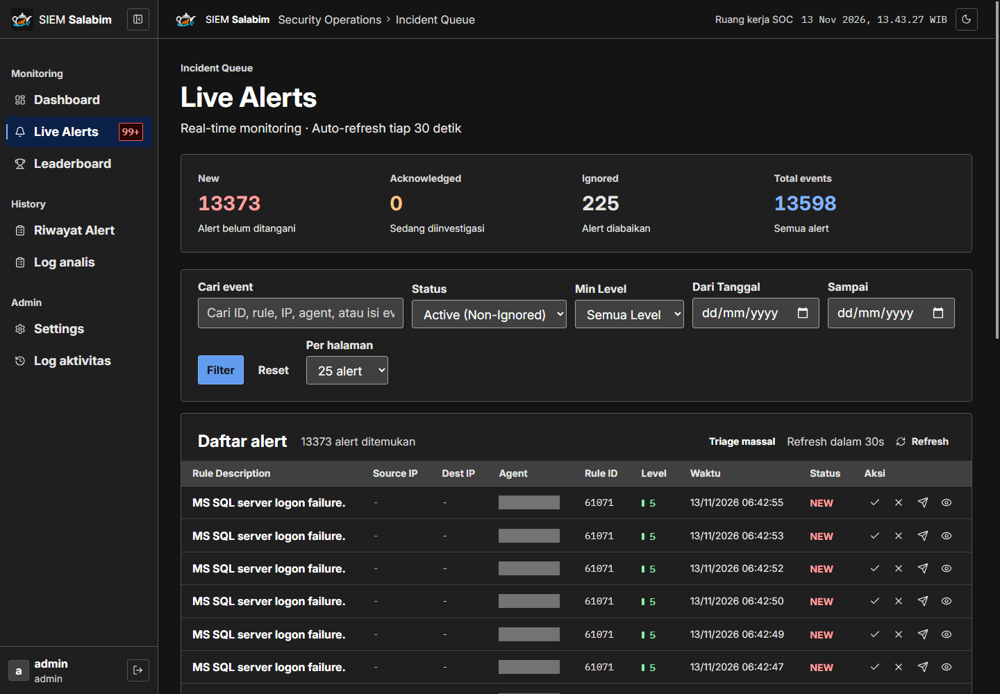](docs/asset/admin-live-alerts.png)

[← Sebelumnya](#preview-10) · [Daftar bagian](#galeri) · [Berikutnya →](#preview-12)

---

<a id="preview-12"></a>

#### 12 / 49 — Daftar Live Alerts untuk analis

**Bagian:** Monitoring → Live Alerts → Detail alert · **Akses:** Analis · **Halaman:** `/live-alerts`.

**Untuk apa:** Daftar alert dari agent yang diizinkan. Analis memakainya untuk menemukan kejadian yang perlu ditangani; tindakan ACK, ignore, Telegram, dan AI mengikuti privilege yang diberikan admin.

[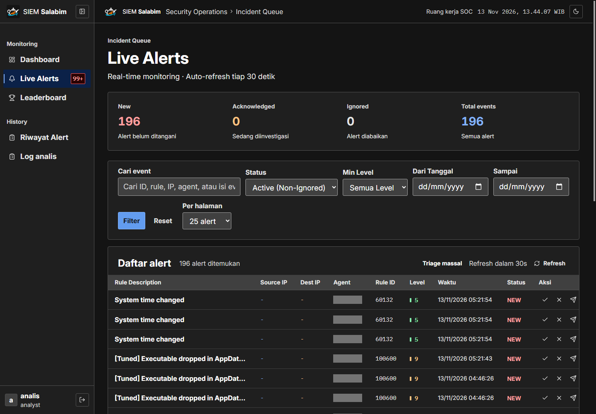](docs/asset/analis-live-alerts.png)

[← Sebelumnya](#preview-11) · [Daftar bagian](#galeri) · [Berikutnya →](#preview-13)

---

<a id="preview-13"></a>

#### 13 / 49 — Detail satu alert untuk admin

**Bagian:** Monitoring → Live Alerts → Detail alert · **Akses:** Admin · **Halaman:** `/alerts/{id}`.

**Untuk apa:** Halaman investigasi satu kejadian yang menampilkan ringkasan dan metadata Wazuh dalam JSON. Admin dapat memeriksa konteks alert sebelum menjalankan analisis atau tindak lanjut.

[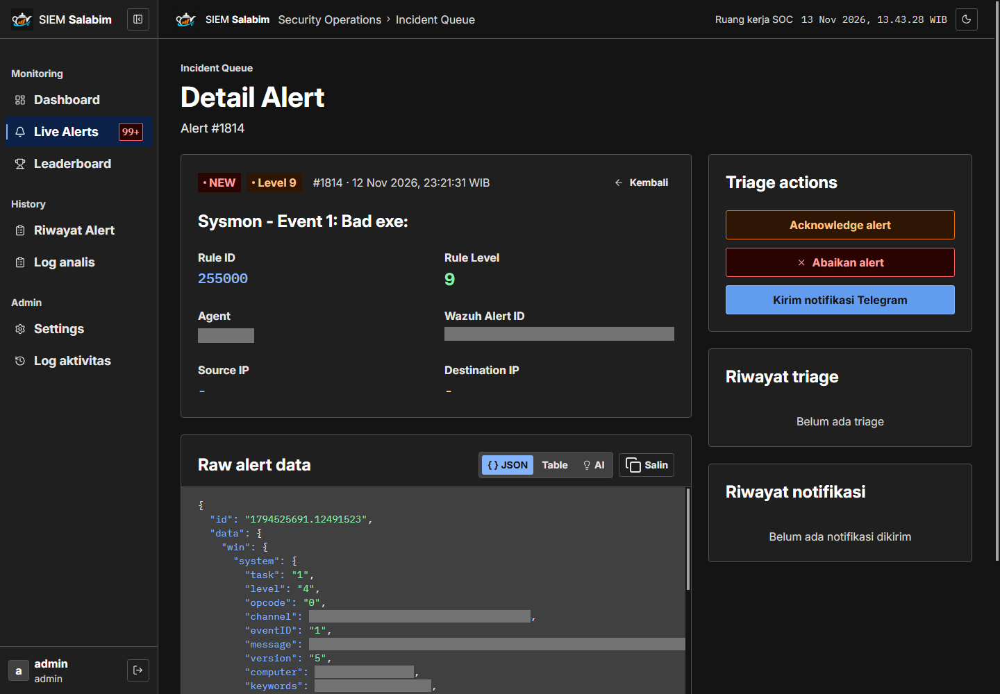](docs/asset/admin-alert-detail.png)

[← Sebelumnya](#preview-12) · [Daftar bagian](#galeri) · [Berikutnya →](#preview-14)

---

<a id="preview-14"></a>

#### 14 / 49 — Detail satu alert untuk analis

**Bagian:** Monitoring → Live Alerts → Detail alert · **Akses:** Analis · **Halaman:** `/alerts/{id}`.

**Untuk apa:** Tampilan detail alert dalam cakupan agent analis. Bukti dapat ditinjau di halaman ini, sedangkan tindakan yang tersedia mengikuti hak akun.

[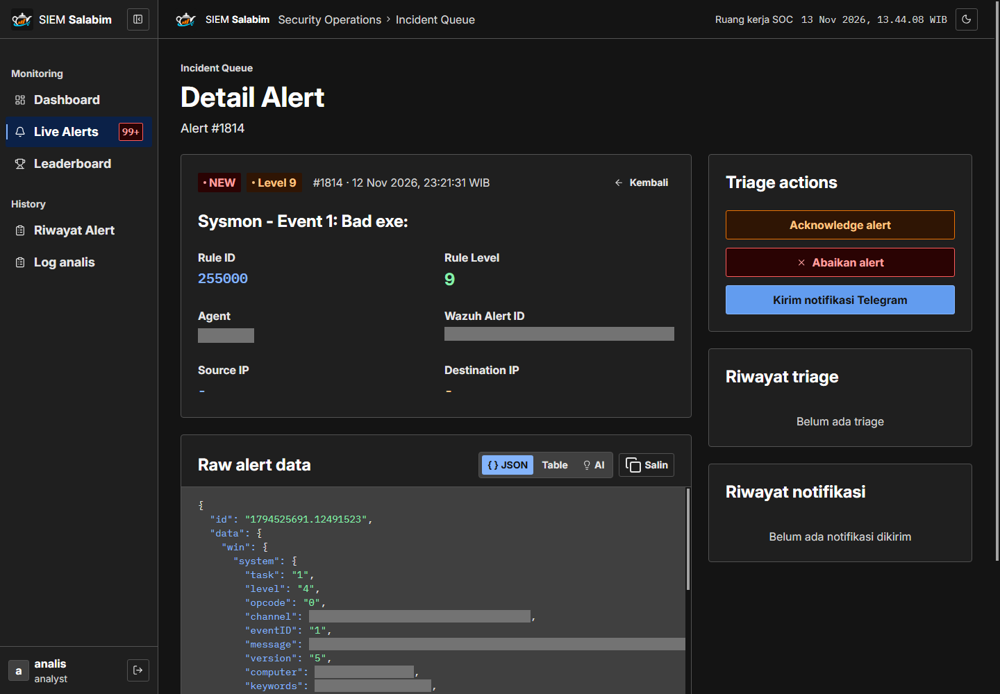](docs/asset/analis-alert-detail.png)

[← Sebelumnya](#preview-13) · [Daftar bagian](#galeri) · [Berikutnya →](#preview-15)

---

<a id="preview-15"></a>

#### 15 / 49 — Bukti alert dalam tabel untuk admin

**Bagian:** Monitoring → Live Alerts → Detail alert · **Akses:** Admin · **Halaman:** `/alerts/{id} → tab Table`.

**Untuk apa:** Alternatif pembacaan metadata Wazuh sebagai pasangan nama field dan nilai. Tampilan tabel membantu menelusuri bukti tanpa membaca struktur JSON secara langsung.

[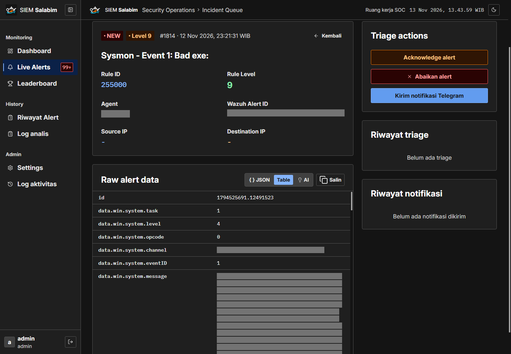](docs/asset/admin-alert-evidence-table.png)

[← Sebelumnya](#preview-14) · [Daftar bagian](#galeri) · [Berikutnya →](#preview-16)

---

<a id="preview-16"></a>

#### 16 / 49 — Bukti alert dalam tabel untuk analis

**Bagian:** Monitoring → Live Alerts → Detail alert · **Akses:** Analis · **Halaman:** `/alerts/{id} → tab Table`.

**Untuk apa:** Metadata alert yang sama disajikan dalam tabel untuk analis yang berhak mengaksesnya. Nama field asli tetap dipertahankan agar pemeriksaan dapat dirujukkan kembali ke log sumber.

[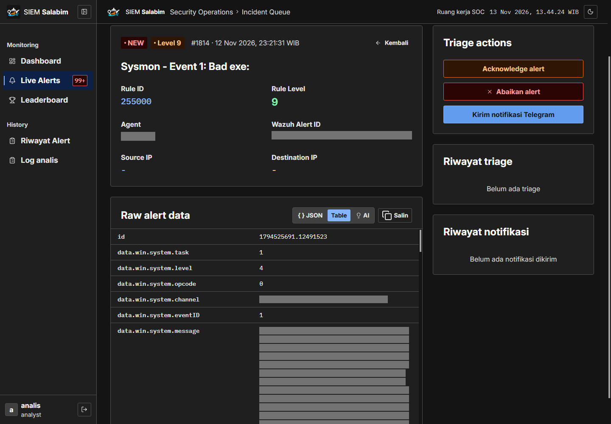](docs/asset/analis-alert-evidence-table.png)

[← Sebelumnya](#preview-15) · [Daftar bagian](#galeri) · [Berikutnya →](#preview-17)

---

<a id="preview-17"></a>

#### 17 / 49 — Analisis AI satu alert untuk admin

**Bagian:** Monitoring → Live Alerts → Detail alert · **Akses:** Admin · **Halaman:** `/alerts/{id} → tab AI`.

**Untuk apa:** Hasil AI tersimpan untuk membantu menilai indikator mencurigakan, kemungkinan aktivitas normal, keterbatasan bukti, dan rekomendasi pemeriksaan. Hasil ini mendampingi penilaian analis saat menentukan tindak lanjut.

[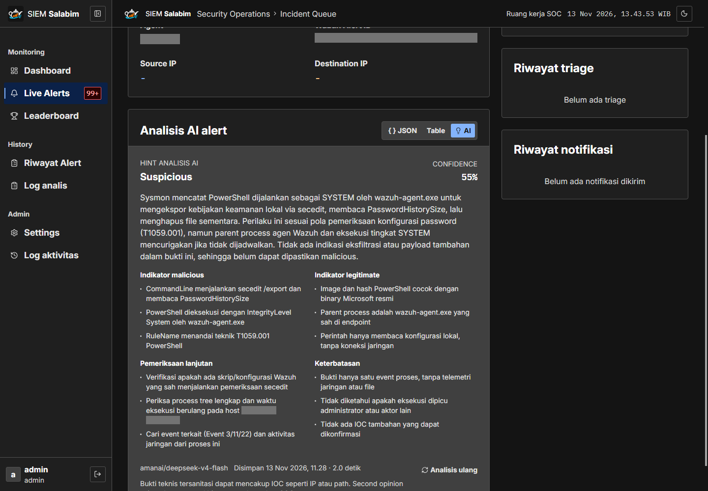](docs/asset/admin-alert-ai.png)

[← Sebelumnya](#preview-16) · [Daftar bagian](#galeri) · [Berikutnya →](#preview-18)

---

<a id="preview-18"></a>

#### 18 / 49 — Analisis AI satu alert untuk analis

**Bagian:** Monitoring → Live Alerts → Detail alert · **Akses:** Analis · **Halaman:** `/alerts/{id} → tab AI`.

**Untuk apa:** Contoh hasil analisis AI pada alert yang berada dalam cakupan analis. Menjalankan analisis memerlukan privilege AI; bukti tetap perlu diverifikasi sebelum menetapkan keputusan.

[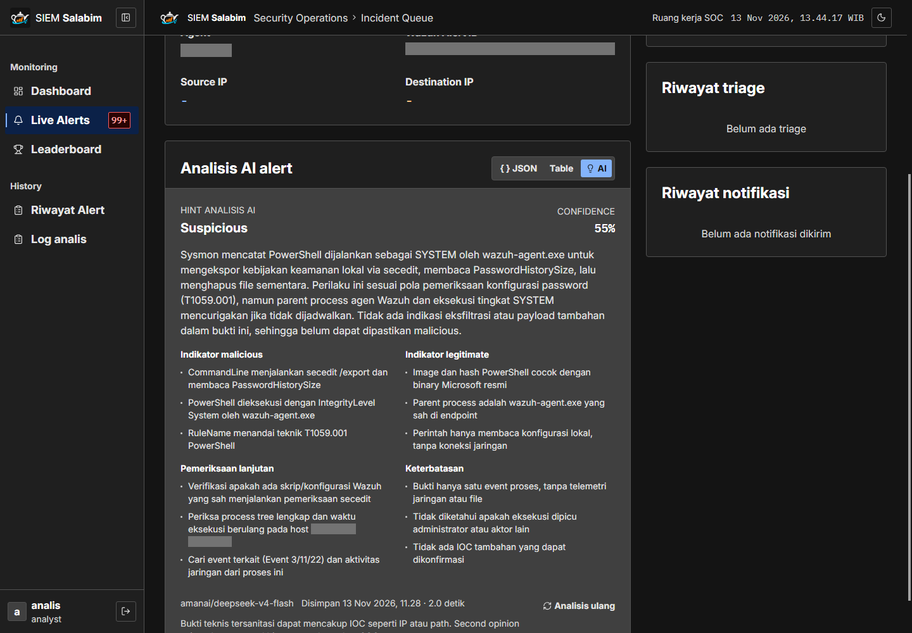](docs/asset/analis-alert-ai.png)

[← Sebelumnya](#preview-17) · [Daftar bagian](#galeri) · [Berikutnya →](#preview-19)
</details>
---

<a id="preview-triage"></a>
<details>
<summary><strong>4. Triage massal, kronologi, dan notifikasi</strong></summary>

Meninjau hubungan beberapa alert dan memeriksa pesan sebelum mengomunikasikan temuan.

<a id="preview-19"></a>

#### 19 / 49 — Detail dan analisis massal untuk admin

**Bagian:** Live Alerts → Triage massal / Detail alert → Telegram · **Akses:** Admin · **Halaman:** `/live-alerts/triage/detail`.

**Untuk apa:** Halaman gabungan untuk meninjau hingga 100 alert pilihan, termasuk ringkasan agent/rule dan bukti per kejadian. Admin dapat membandingkan log sebelum melakukan ACK atau ignore massal.

[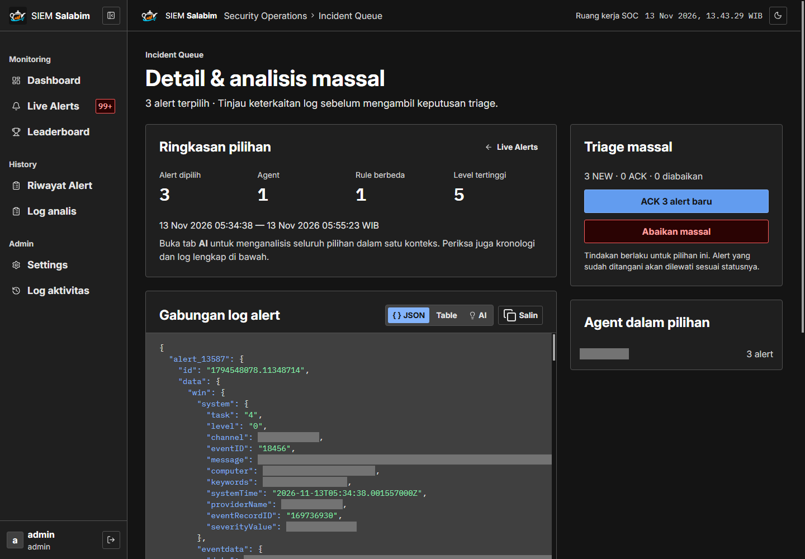](docs/asset/admin-bulk-triage.png)

[← Sebelumnya](#preview-18) · [Daftar bagian](#galeri) · [Berikutnya →](#preview-20)

---

<a id="preview-20"></a>

#### 20 / 49 — Detail dan analisis massal untuk analis

**Bagian:** Live Alerts → Triage massal / Detail alert → Telegram · **Akses:** Analis · **Halaman:** `/live-alerts/triage/detail`.

**Untuk apa:** Peninjauan bersama beberapa alert dari agent yang diizinkan. Analis dapat menilai keterkaitan kejadian dan menjalankan tindakan massal sesuai privilege akun.

[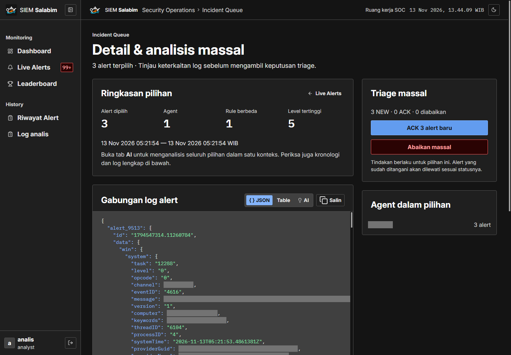](docs/asset/analis-bulk-triage.png)

[← Sebelumnya](#preview-19) · [Daftar bagian](#galeri) · [Berikutnya →](#preview-21)

---

<a id="preview-21"></a>

#### 21 / 49 — Kronologi alert pilihan untuk admin

**Bagian:** Live Alerts → Triage massal / Detail alert → Telegram · **Akses:** Admin · **Halaman:** `/live-alerts/triage/detail → kronologi`.

**Untuk apa:** Urutan kejadian dari yang paling lama ke paling baru untuk membantu membaca hubungan waktu antaralert. Setiap kejadian dapat dirujuk kembali saat menyusun kesimpulan investigasi.

[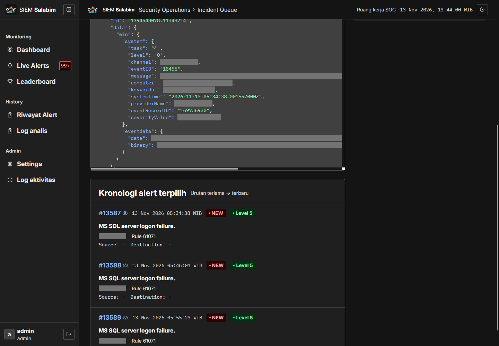](docs/asset/admin-bulk-timeline.png)

[← Sebelumnya](#preview-20) · [Daftar bagian](#galeri) · [Berikutnya →](#preview-22)

---

<a id="preview-22"></a>

#### 22 / 49 — Kronologi alert pilihan untuk analis

**Bagian:** Live Alerts → Triage massal / Detail alert → Telegram · **Akses:** Analis · **Halaman:** `/live-alerts/triage/detail → kronologi`.

**Untuk apa:** Linimasa alert yang dipilih analis dalam cakupan aksesnya. Tampilan ini membantu memeriksa urutan aktivitas sebelum menyimpulkan apakah beberapa alert saling berkaitan.

[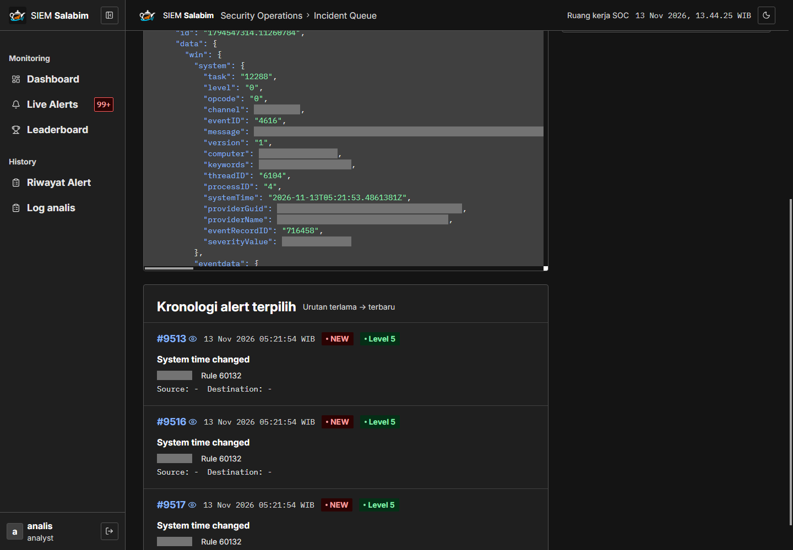](docs/asset/analis-bulk-timeline.png)

[← Sebelumnya](#preview-21) · [Daftar bagian](#galeri) · [Berikutnya →](#preview-23)

---

<a id="preview-23"></a>

#### 23 / 49 — Pratinjau notifikasi Telegram untuk admin

**Bagian:** Live Alerts → Triage massal / Detail alert → Telegram · **Akses:** Admin · **Halaman:** `/alerts/{id} → pratinjau Telegram`.

**Untuk apa:** Dialog untuk meninjau isi notifikasi temuan sebelum dikirim. Tujuan pengiriman mengikuti pemetaan agent di Settings, sehingga admin dapat memeriksa pesan dalam konteks alert yang sedang diselidiki.

[](docs/asset/admin-telegram-preview.png)

[← Sebelumnya](#preview-22) · [Daftar bagian](#galeri) · [Berikutnya →](#preview-24)

---

<a id="preview-24"></a>

#### 24 / 49 — Pratinjau notifikasi Telegram untuk analis

**Bagian:** Live Alerts → Triage massal / Detail alert → Telegram · **Akses:** Analis · **Halaman:** `/alerts/{id} → pratinjau Telegram`.

**Untuk apa:** Contoh pesan Telegram dari sisi analis. Pengiriman memerlukan privilege Telegram dan tetap memakai tujuan yang telah diatur admin.

[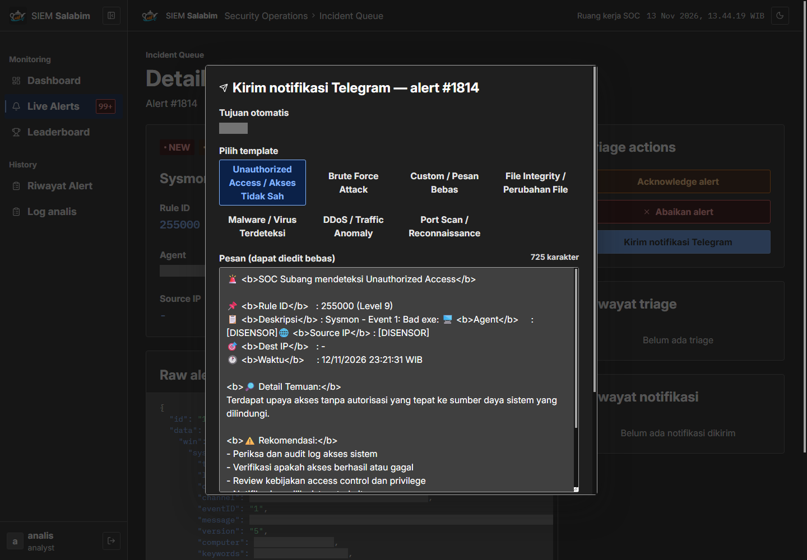](docs/asset/analis-telegram-preview.png)

[← Sebelumnya](#preview-23) · [Daftar bagian](#galeri) · [Berikutnya →](#preview-25)
</details>
---

<a id="preview-riwayat"></a>
<details>
<summary><strong>5. Riwayat, kinerja SOC, dan audit</strong></summary>

Menelusuri penanganan alert, mengevaluasi pekerjaan SOC, dan memeriksa aktivitas administrasi.

<a id="preview-25"></a>

#### 25 / 49 — Riwayat alert untuk admin

**Bagian:** History / Monitoring → Leaderboard / Admin → Log aktivitas · **Akses:** Admin · **Halaman:** `/history/alerts`.

**Untuk apa:** Daftar historis alert yang dapat ditelusuri kembali oleh admin. Halaman ini membantu meninjau kejadian dan status penanganannya setelah tahap monitoring awal.

[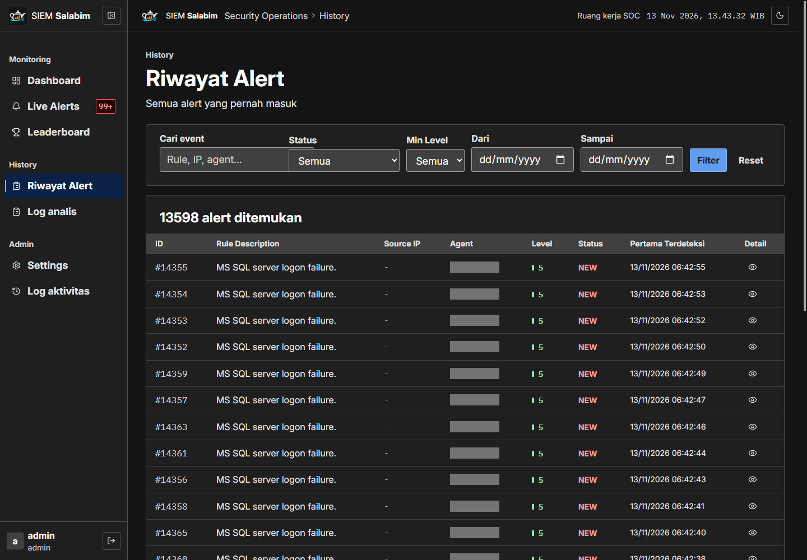](docs/asset/admin-alert-history.png)

[← Sebelumnya](#preview-24) · [Daftar bagian](#galeri) · [Berikutnya →](#preview-26)

---

<a id="preview-26"></a>

#### 26 / 49 — Riwayat alert untuk analis

**Bagian:** History / Monitoring → Leaderboard / Admin → Log aktivitas · **Akses:** Analis · **Halaman:** `/history/alerts`.

**Untuk apa:** Riwayat alert dalam cakupan agent analis. Pengguna dapat meninjau kembali kejadian yang relevan dengan tanggung jawabnya.

[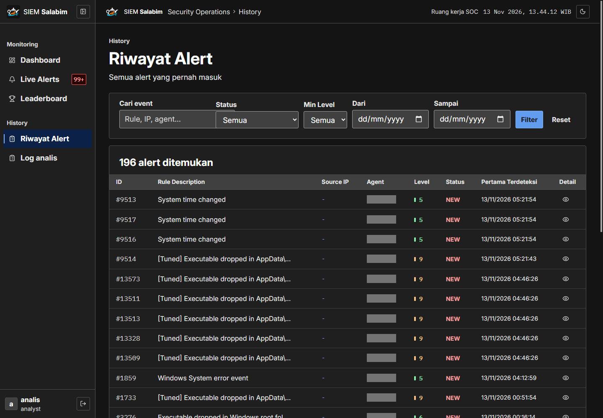](docs/asset/analis-alert-history.png)

[← Sebelumnya](#preview-25) · [Daftar bagian](#galeri) · [Berikutnya →](#preview-27)

---

<a id="preview-27"></a>

#### 27 / 49 — Log analis dari sisi admin

**Bagian:** History / Monitoring → Leaderboard / Admin → Log aktivitas · **Akses:** Admin · **Halaman:** `/analyst-log`.

**Untuk apa:** Riwayat tindakan ACK, ignore, dan pengiriman Telegram, termasuk hasil pengiriman yang gagal. Admin dapat mencari serta memfilter aksi dan waktu untuk menelusuri tindak lanjut SOC.

[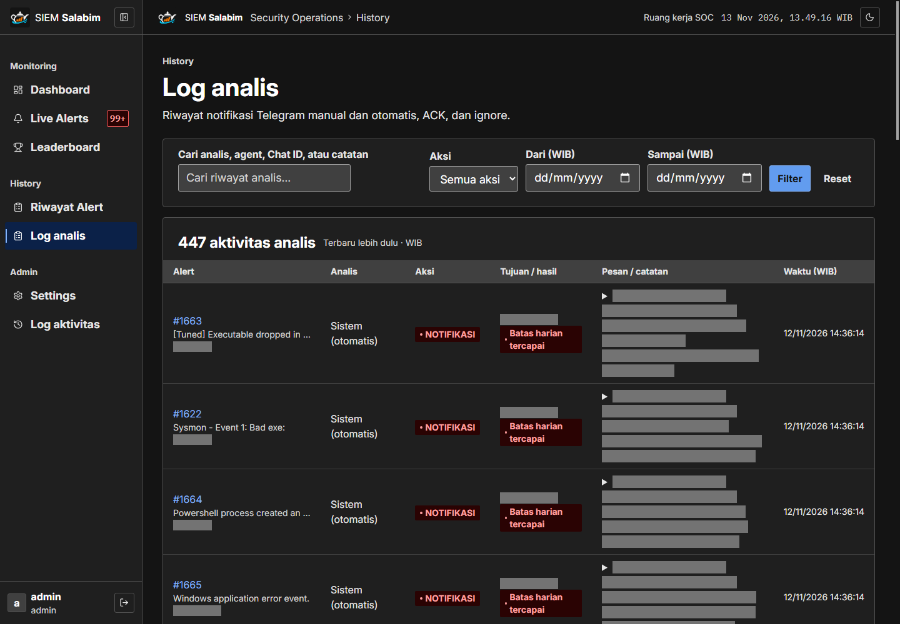](docs/asset/admin-analyst-log.png)

[← Sebelumnya](#preview-26) · [Daftar bagian](#galeri) · [Berikutnya →](#preview-28)

---

<a id="preview-28"></a>

#### 28 / 49 — Log analis dalam cakupan akses analis

**Bagian:** History / Monitoring → Leaderboard / Admin → Log aktivitas · **Akses:** Analis · **Halaman:** `/analyst-log`.

**Untuk apa:** Catatan triage dan notifikasi yang mengikuti cakupan agent akun analis. Halaman ini membantu menelusuri tindakan yang sudah dilakukan pada alert yang dapat diakses.

[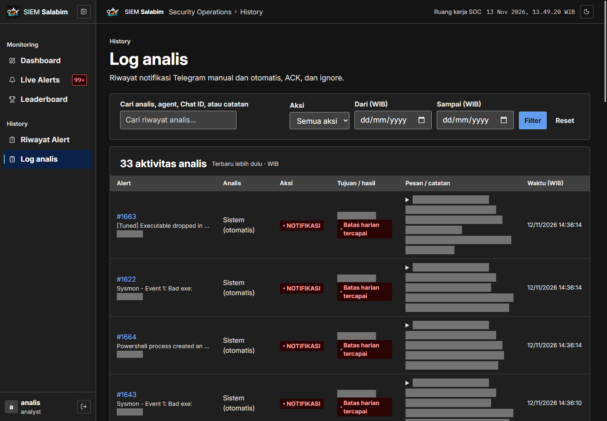](docs/asset/analis-analyst-log.png)

[← Sebelumnya](#preview-27) · [Daftar bagian](#galeri) · [Berikutnya →](#preview-29)

---

<a id="preview-29"></a>

#### 29 / 49 — Kinerja tim SOC untuk admin

**Bagian:** History / Monitoring → Leaderboard / Admin → Log aktivitas · **Akses:** Admin · **Halaman:** `/leaderboard`.

**Untuk apa:** Ringkasan kinerja penanganan alert untuk pemantauan aktivitas tim. Admin dapat menggunakannya sebagai bahan evaluasi pembagian dan tindak lanjut pekerjaan SOC.

[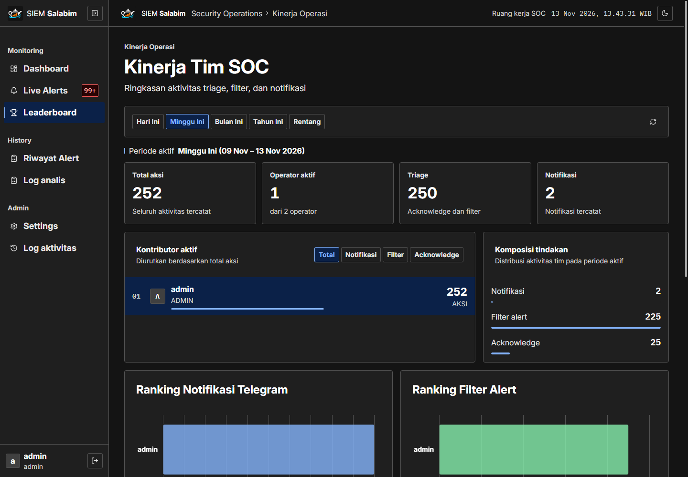](docs/asset/admin-leaderboard.png)

[← Sebelumnya](#preview-28) · [Daftar bagian](#galeri) · [Berikutnya →](#preview-30)

---

<a id="preview-30"></a>

#### 30 / 49 — Kinerja akun analis

**Bagian:** History / Monitoring → Leaderboard / Admin → Log aktivitas · **Akses:** Analis · **Halaman:** `/leaderboard`.

**Untuk apa:** Statistik kinerja untuk akun analis yang sedang masuk. Analis dapat meninjau aktivitas penanganannya sendiri.

[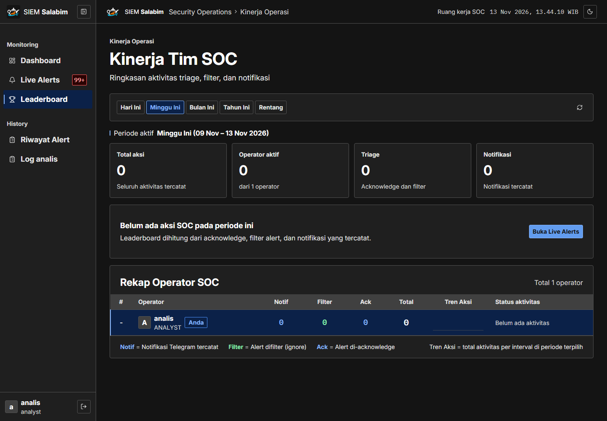](docs/asset/analis-leaderboard.png)

[← Sebelumnya](#preview-29) · [Daftar bagian](#galeri) · [Berikutnya →](#preview-31)

---

<a id="preview-31"></a>

#### 31 / 49 — Audit Log aktivitas khusus admin

**Bagian:** History / Monitoring → Leaderboard / Admin → Log aktivitas · **Akses:** Admin · **Halaman:** `/history/activity`.

**Untuk apa:** Catatan akses akun, perubahan profil, pengelolaan user, dan aktivitas Settings beserta pelaku, hasil, serta waktu. Halaman ini membantu admin menelusuri perubahan dan memeriksa keberhasilan atau kegagalan tindakan.

[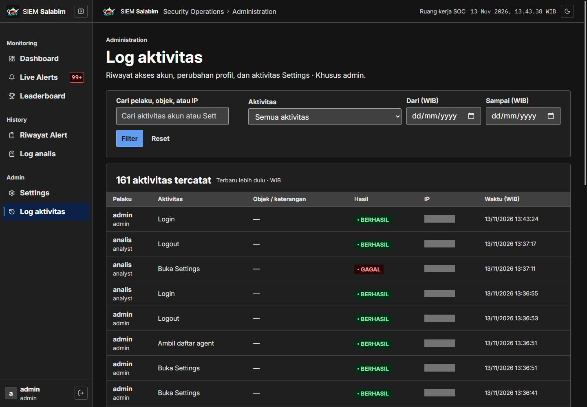](docs/asset/admin-activity-log.png)

[← Sebelumnya](#preview-30) · [Daftar bagian](#galeri) · [Berikutnya →](#preview-32)
</details>
---

<a id="preview-settings"></a>
<details>
<summary><strong>6. Settings dan integrasi</strong></summary>

Menghubungkan sumber alert, mengatur analisis dan notifikasi, serta mengelola data aplikasi.

<a id="preview-32"></a>

#### 32 / 49 — Daftar bagian Settings

**Bagian:** Admin → Settings · **Akses:** Admin · **Halaman:** `/settings`.

**Untuk apa:** Pintu masuk konfigurasi aplikasi yang terdiri dari panel-panel yang dapat dibuka pada halaman yang sama. Admin memilih bagian OpenSearch, ignore permanen, AI, Telegram, manajemen user, atau manajemen data.

[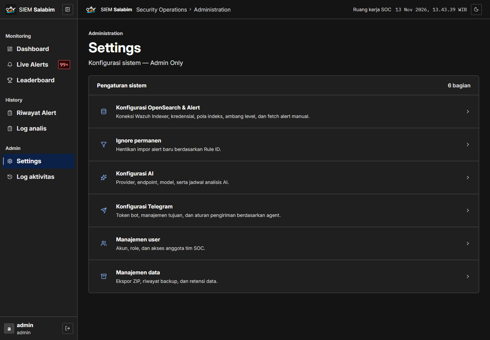](docs/asset/admin-settings.png)

[← Sebelumnya](#preview-31) · [Daftar bagian](#galeri) · [Berikutnya →](#preview-33)

---

<a id="preview-33"></a>

#### 33 / 49 — Koneksi OpenSearch dan ambang alert

**Bagian:** Admin → Settings · **Akses:** Admin · **Halaman:** `/settings?section=opensearch`.

**Untuk apa:** Formulir koneksi Wazuh Indexer/OpenSearch, pola indeks, dan ambang level impor alert. Admin dapat menguji koneksi serta mengambil alert secara manual dari bagian ini.

[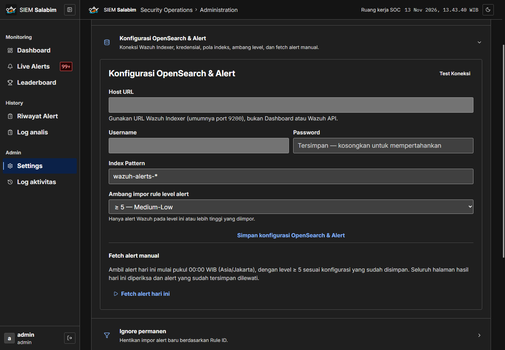](docs/asset/admin-settings-opensearch.png)

[← Sebelumnya](#preview-32) · [Daftar bagian](#galeri) · [Berikutnya →](#preview-34)

---

<a id="preview-34"></a>

#### 34 / 49 — Pengecualian impor berdasarkan Rule ID

**Bagian:** Admin → Settings · **Akses:** Admin · **Halaman:** `/settings?section=permanent-ignore`.

**Untuk apa:** Daftar Rule ID yang dikecualikan dari impor alert baru. Pengaturan ini membantu mengurangi alert yang tidak perlu diimpor tanpa mengubah alert historis yang sudah tersimpan.

[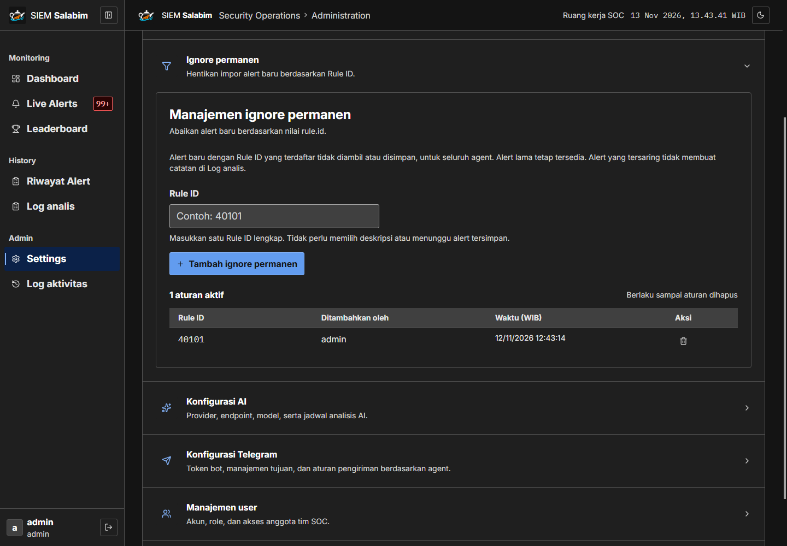](docs/asset/admin-settings-permanent-ignore.png)

[← Sebelumnya](#preview-33) · [Daftar bagian](#galeri) · [Berikutnya →](#preview-35)

---

<a id="preview-35"></a>

#### 35 / 49 — Konfigurasi layanan AI

**Bagian:** Admin → Settings · **Akses:** Admin · **Halaman:** `/settings?section=ai`.

**Untuk apa:** Pengaturan provider, endpoint, kredensial, model, dan analisis AI. Admin menyesuaikannya dengan layanan AI yang digunakan untuk ringkasan dashboard dan investigasi alert.

[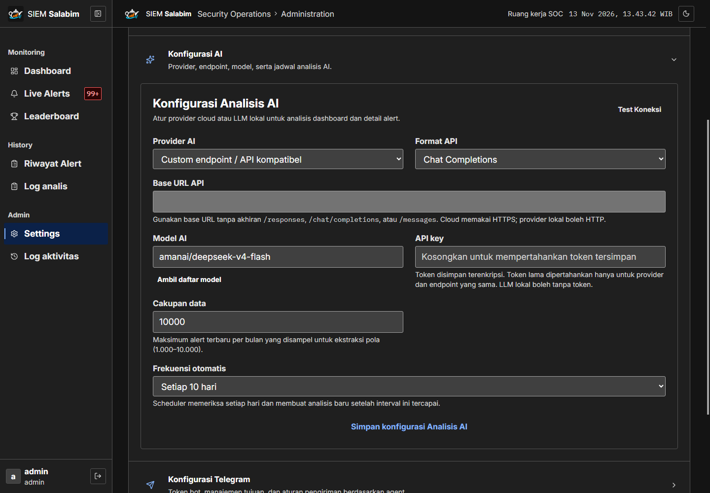](docs/asset/admin-settings-ai.png)

[← Sebelumnya](#preview-34) · [Daftar bagian](#galeri) · [Berikutnya →](#preview-36)

---

<a id="preview-36"></a>

#### 36 / 49 — Tujuan Telegram dan pemetaan agent

**Bagian:** Admin → Settings · **Akses:** Admin · **Halaman:** `/settings?section=telegram`.

**Untuk apa:** Pengaturan bot, label tujuan, chat/grup, serta pemetaan agent ke tujuan notifikasi. Pemetaan ini menentukan penerima pesan saat temuan dari suatu agent dikirim.

[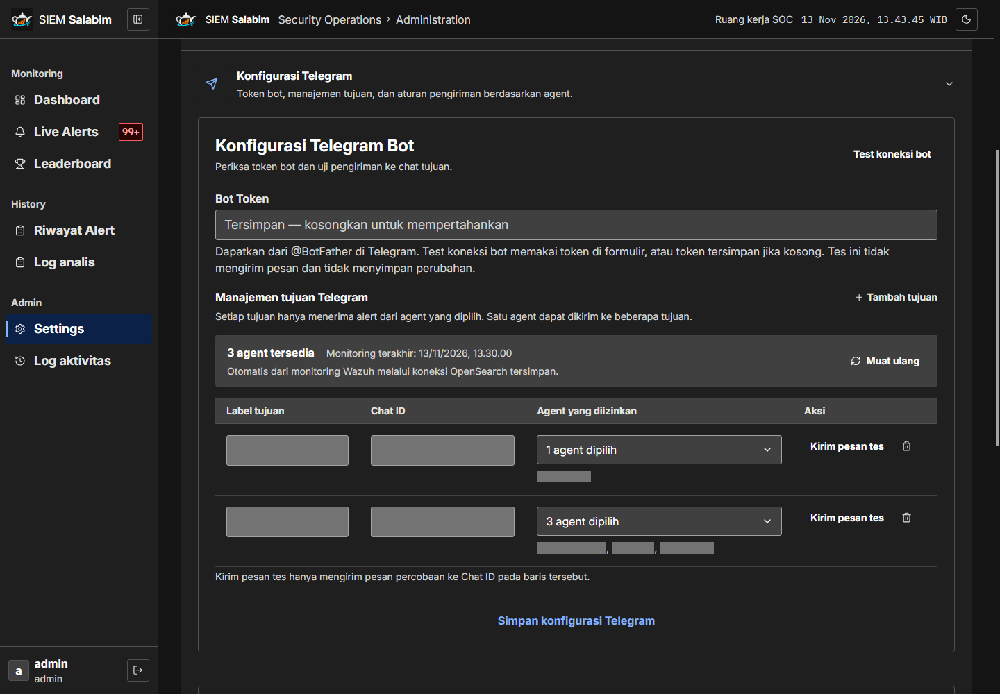](docs/asset/admin-settings-telegram.png)

[← Sebelumnya](#preview-35) · [Daftar bagian](#galeri) · [Berikutnya →](#preview-37)

---

<a id="preview-37"></a>

#### 37 / 49 — Notifikasi otomatis dan batas harian

**Bagian:** Admin → Settings · **Akses:** Admin · **Halaman:** `/settings?section=telegram → notifikasi otomatis`.

**Untuk apa:** Panel untuk mengaktifkan pengiriman alert baru secara otomatis, menentukan ambang level, dan membatasi notifikasi yang sama per hari. Admin dapat mengatur komunikasi rutin sambil mengendalikan pengulangan pesan.

[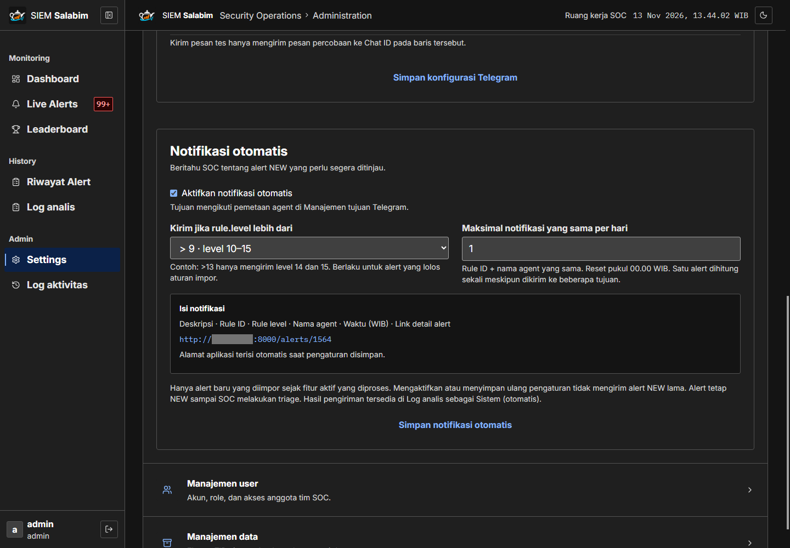](docs/asset/admin-settings-automatic-notifications.png)

[← Sebelumnya](#preview-36) · [Daftar bagian](#galeri) · [Berikutnya →](#preview-38)

---

<a id="preview-38"></a>

#### 38 / 49 — Ekspor, backup, dan retensi data

**Bagian:** Admin → Settings · **Akses:** Admin · **Halaman:** `/settings?section=data`.

**Untuk apa:** Panel untuk memilih cakupan/periode data, melihat preview, membuat ekspor ZIP, dan meninjau riwayat backup. Unduhan memerlukan verifikasi password akun; purge tersedia dari ekspor yang telah diverifikasi.

[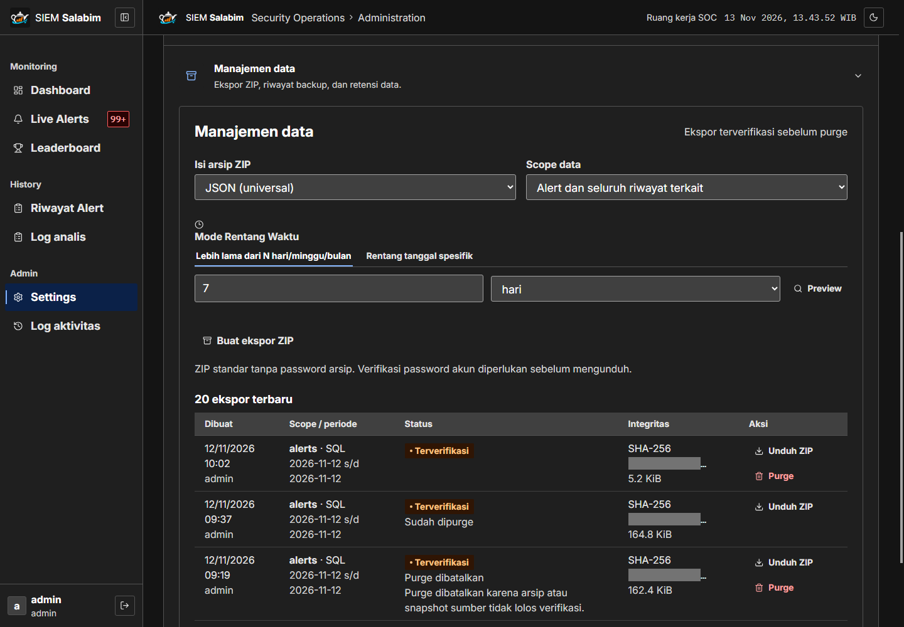](docs/asset/admin-settings-data.png)

[← Sebelumnya](#preview-37) · [Daftar bagian](#galeri) · [Berikutnya →](#preview-39)

---

<a id="preview-39"></a>

#### 39 / 49 — Daftar akun dan akses pengguna

**Bagian:** Admin → Settings · **Akses:** Admin · **Halaman:** `/settings?section=users`.

**Untuk apa:** Tabel pengguna yang memperlihatkan role serta cakupan akses akun. Admin memakai bagian ini untuk menambah pengguna atau membuka pengaturan akun yang sudah ada.

[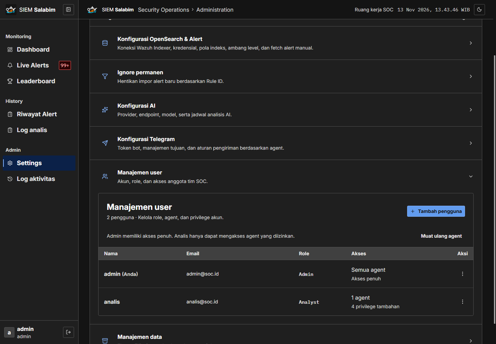](docs/asset/admin-settings-users.png)

[← Sebelumnya](#preview-38) · [Daftar bagian](#galeri) · [Berikutnya →](#preview-40)
</details>
---

<a id="preview-akses"></a>

<details>
<summary><strong>7. Manajemen pengguna dan pembatasan akses</strong></summary>

Membuat akun, menentukan agent yang boleh dilihat, dan mengatur hak tindakan setiap pengguna.

<a id="preview-40"></a>

#### 40 / 49 — Menu tindakan pada akun pengguna

**Bagian:** Settings → Manajemen user · **Akses:** Admin · **Halaman:** `/settings?section=users → menu ⋮`.

**Untuk apa:** Menu pada baris pengguna untuk mengedit akun atau mengaktifkan/menonaktifkannya. Penonaktifan mempertahankan riwayat penanganan; screenshot ini diambil sebelum menu Hapus diganti dengan Nonaktifkan akun.

[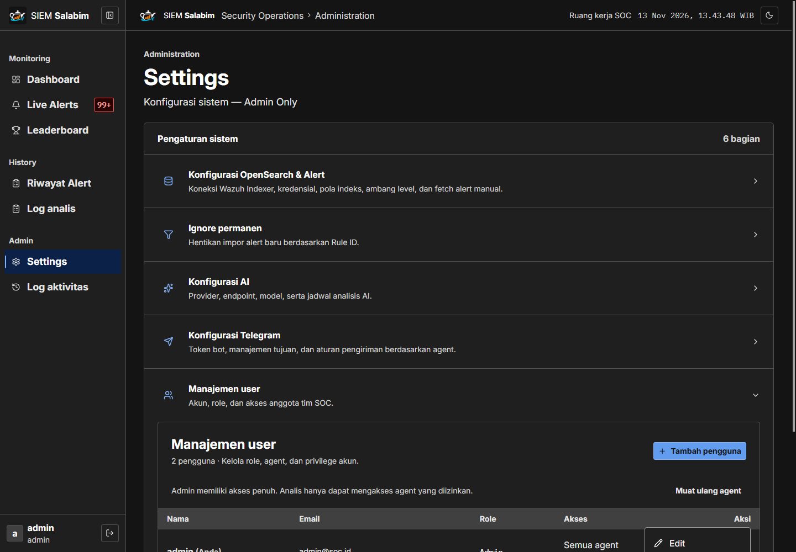](docs/asset/admin-user-actions.png)

[← Sebelumnya](#preview-39) · [Daftar bagian](#galeri) · [Berikutnya →](#preview-41)

---

<a id="preview-41"></a>

#### 41 / 49 — Dialog tambah pengguna

**Bagian:** Settings → Manajemen user · **Akses:** Admin · **Halaman:** `/settings?section=users → Tambah pengguna`.

**Untuk apa:** Formulir pembuatan akun baru dengan identitas, kata sandi, role, pilihan Wazuh Agent ID, dan privilege. Admin menyiapkan akses analis sesuai tugasnya sebelum akun digunakan.

[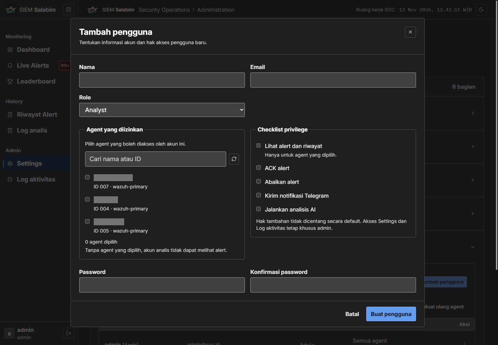](docs/asset/admin-user-create.png)

[← Sebelumnya](#preview-40) · [Daftar bagian](#galeri) · [Berikutnya →](#preview-42)

---

<a id="preview-42"></a>

#### 42 / 49 — Edit role, agent, dan privilege

**Bagian:** Settings → Manajemen user · **Akses:** Admin · **Halaman:** `/settings?section=users → Edit`.

**Untuk apa:** Dialog untuk mengubah identitas akun, cakupan agent, serta hak ACK, ignore, Telegram, dan AI secara terpisah. Admin dapat memberikan atau mencabut izin sesuai tanggung jawab pengguna.

[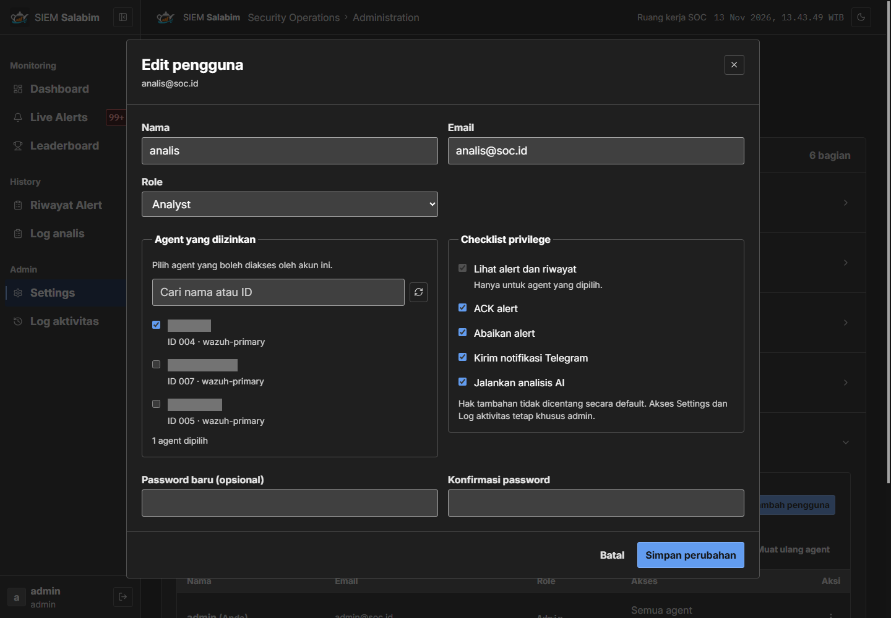](docs/asset/admin-user-privileges.png)

[← Sebelumnya](#preview-41) · [Daftar bagian](#galeri) · [Berikutnya →](#preview-43)

---

<a id="preview-43"></a>

#### 43 / 49 — Penolakan akses Settings untuk analis

**Bagian:** Settings → Manajemen user · **Akses:** Analis · **Halaman:** `/settings`.

**Untuk apa:** Contoh halaman ketika analis mencoba membuka area administrasi. Pembatasan role menjaga agar pengaturan sistem dan pengelolaan pengguna hanya dapat diakses admin.

[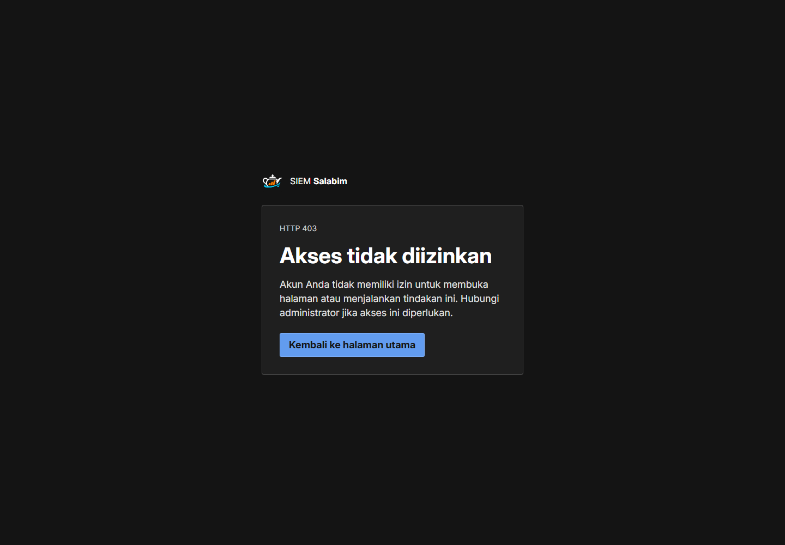](docs/asset/analis-admin-access-denied.png)

[← Sebelumnya](#preview-42) · [Daftar bagian](#galeri) · [Berikutnya →](#preview-44)
</details>
---

<a id="preview-akun"></a>

<details>
<summary><strong>8. Profil dan keamanan akun</strong></summary>

Memperbarui identitas, mengganti kata sandi, dan mengenali halaman konfirmasi serta verifikasi email.

<a id="preview-44"></a>

#### 44 / 49 — Profil dan kata sandi admin

**Bagian:** Profile / Keamanan akun · **Akses:** Admin · **Halaman:** `/profile`.

**Untuk apa:** Halaman untuk memperbarui nama/email dan mengganti kata sandi akun admin sendiri. Perubahan kata sandi memerlukan kata sandi yang sedang digunakan.

[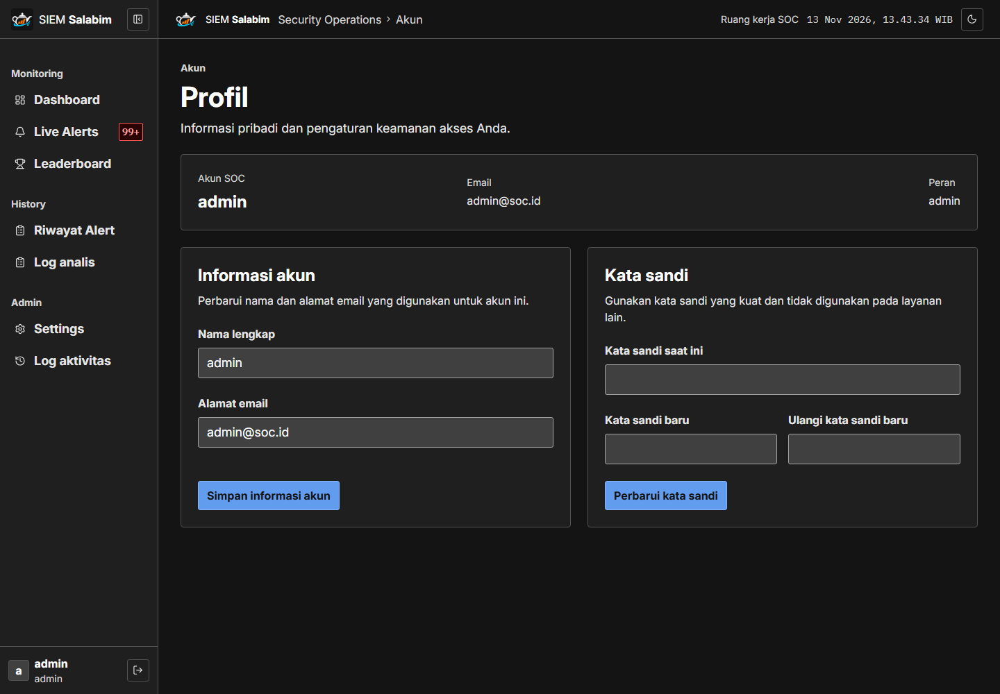](docs/asset/admin-profile.png)

[← Sebelumnya](#preview-43) · [Daftar bagian](#galeri) · [Berikutnya →](#preview-45)

---

<a id="preview-45"></a>

#### 45 / 49 — Profil dan kata sandi analis

**Bagian:** Profile / Keamanan akun · **Akses:** Analis · **Halaman:** `/profile`.

**Untuk apa:** Pengaturan identitas dan kata sandi akun analis sendiri. Pengelolaan profil tersedia tanpa memberi akses ke Settings administrasi.

[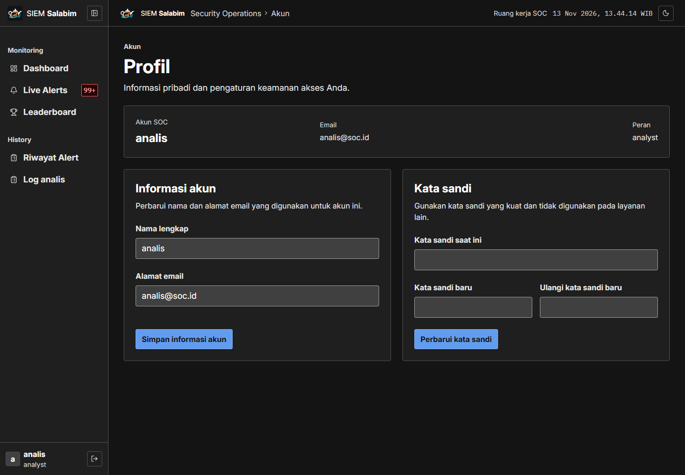](docs/asset/analis-profile.png)

[← Sebelumnya](#preview-44) · [Daftar bagian](#galeri) · [Berikutnya →](#preview-46)

---

<a id="preview-46"></a>

#### 46 / 49 — Konfirmasi akses akun admin

**Bagian:** Profile / Keamanan akun · **Akses:** Admin · **Halaman:** `/confirm-password`.

**Untuk apa:** Formulir untuk memasukkan kembali kata sandi akun admin ketika konfirmasi akses diperlukan. Identitas akun ditampilkan agar pengguna mengetahui akun yang sedang digunakan.

[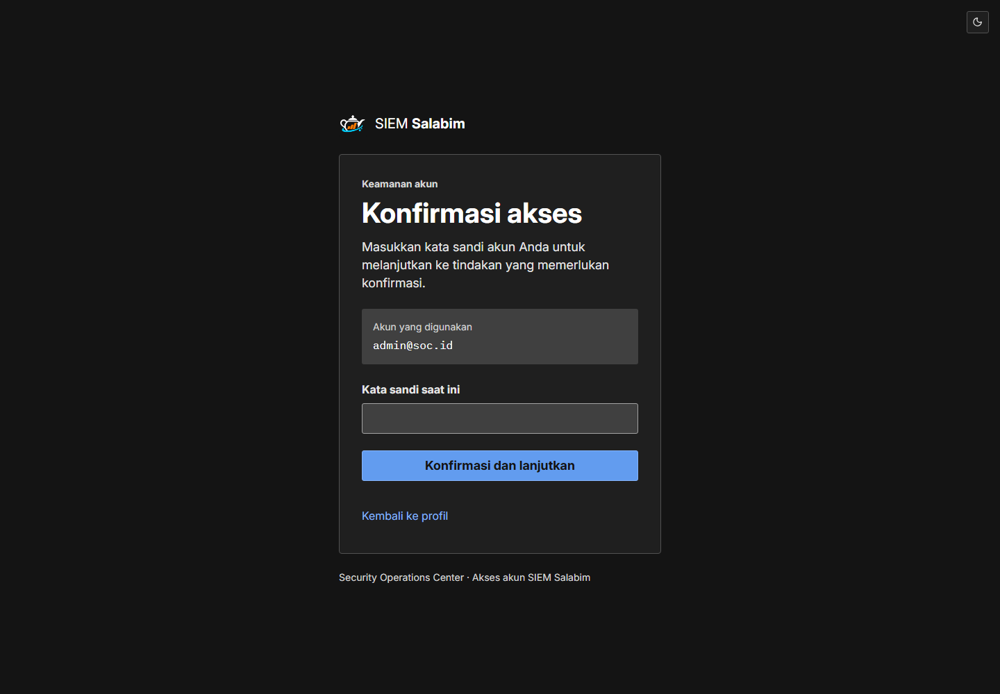](docs/asset/admin-confirm-password.png)

[← Sebelumnya](#preview-45) · [Daftar bagian](#galeri) · [Berikutnya →](#preview-47)

---

<a id="preview-47"></a>

#### 47 / 49 — Konfirmasi akses akun analis

**Bagian:** Profile / Keamanan akun · **Akses:** Analis · **Halaman:** `/confirm-password`.

**Untuk apa:** Formulir konfirmasi kata sandi dari sisi analis. Halaman ini meminta verifikasi ulang identitas akun sebelum melanjutkan tindakan yang memerlukan konfirmasi.

[](docs/asset/analis-confirm-password.png)

[← Sebelumnya](#preview-46) · [Daftar bagian](#galeri) · [Berikutnya →](#preview-48)

---

<a id="preview-48"></a>

#### 48 / 49 — Verifikasi email akun admin

**Bagian:** Profile / Keamanan akun · **Akses:** Admin · **Halaman:** `/verify-email`.

**Untuk apa:** Halaman instruksi verifikasi alamat email yang menyediakan pengiriman ulang tautan dan akses untuk memeriksa alamat akun. Pengiriman email memerlukan konfigurasi SMTP yang sesuai.

[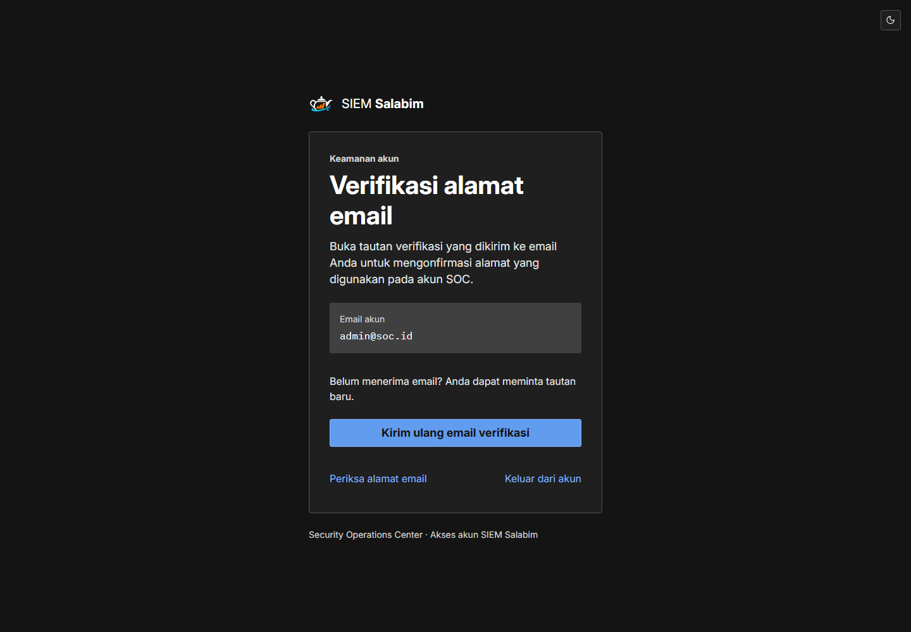](docs/asset/admin-verify-email.png)

[← Sebelumnya](#preview-47) · [Daftar bagian](#galeri) · [Berikutnya →](#preview-49)

---

<a id="preview-49"></a>

#### 49 / 49 — Verifikasi email akun analis

**Bagian:** Profile / Keamanan akun · **Akses:** Analis · **Halaman:** `/verify-email`.

**Untuk apa:** Instruksi konfirmasi alamat email dari sisi analis, termasuk pilihan meminta tautan baru. Halaman ini membantu pengguna memastikan alamat email yang digunakan pada akun SOC.

[](docs/asset/analis-verify-email.png)

[← Sebelumnya](#preview-48) · [Daftar bagian](#galeri) · [Lanjut ke fitur →](#fitur)
</details>

<details>
<summary><strong>Informasi pengambilan screenshot dan penyamaran data</strong></summary>

Tangkapan layar diambil langsung pada **13 November 2026**, menggunakan akun dummy admin dan analis pada aplikasi yang berjalan. Viewport desktop berukuran **1440 × 1000**; tangkapan dashboard lengkap memuat seluruh tinggi halaman. Akun pada gambar merupakan akun dokumentasi lokal, **bukan akun bawaan instalasi**; password tidak dicantumkan.

Admin pada contoh dapat melihat seluruh agent. Akun analis hanya mendapat satu agent dan privilege tindakan yang telah dipilih admin. Perbedaan angka, menu, dan hasil analisis mengikuti hak akses tersebut. Klik gambar untuk melihat ukuran aslinya.

Informasi operasional pada screenshot telah disensor dengan penutup solid untuk publikasi: alamat IP, nama agent/host, path file dan registry, hash, identitas tujuan Telegram, serta nilai string pada log mentah. Statistik, Rule ID, label antarmuka, dan akun dummy tetap terlihat. Sensor diterapkan pada tangkapan layar dokumentasi; log asli pada aplikasi dan Wazuh tidak diubah. Fixture log pengujian memakai identitas serta alamat contoh.

Galeri desktop mencakup halaman aktif, seluruh panel Settings, dialog manajemen user, pratinjau notifikasi, serta mode terang/gelap. Wizard instalasi tidak diulang pada instalasi yang sudah aktif. Analisis AI yang ditampilkan adalah hasil tersimpan; pengambilan screenshot tidak mengirim notifikasi, menjalankan triage, atau mengubah konfigurasi.

Seluruh gambar tersedia di [`docs/asset`](docs/asset). Daftar file, route, role, tema, ukuran, dan waktu pengambilan tersedia pada [`screenshots.json`](docs/asset/screenshots.json).

</details>

<a id="fitur"></a>

## Fitur

| Fitur | Perilaku aplikasi |
| :--- | :--- |
| **Dashboard SOC** | Tren bulan berjalan, severity, pola MITRE, tindak lanjut, dan kesimpulan AI sesuai cakupan agent akun. |
| **Live Alerts** | Pencarian, filter agent/level/status/tanggal, pembaruan otomatis, serta pilihan 25/50/100 baris. |
| **Detail alert** | Metadata asli `_source` Wazuh dalam JSON dan tabel; nama field, termasuk `rule.description`, tetap dipertahankan. |
| **Triage massal** | Pilih hingga 100 alert, tinjau kronologi, lalu ACK; pemilik ACK dapat ignore atau mengirim satu pesan teks gabungan per tujuan Telegram. |
| **Analisis AI** | Analisis satu alert, korelasi beberapa log, indikator aktivitas normal/mencurigakan, keterbatasan bukti, dan rekomendasi tindakan. |
| **RBAC per agent** | Role admin/analis, checklist agent, dan privilege ACK, ignore, Telegram, serta analisis AI yang terpisah. |
| **Ignore permanen** | Kelola **Rule ID** yang dikecualikan dari impor baru. Alert dan metadata yang sudah tersimpan tetap tersedia. |
| **Telegram multi-tujuan** | Label tujuan, grup/chat pribadi, dan pemetaan agent; tujuan pengiriman dipilih otomatis dari Settings. |
| **Template notifikasi** | Editor yang sama untuk tunggal/massal, pesan bebas, evidence, serta tambah/edit/nonaktifkan/hapus template melalui Settings. |
| **Notifikasi otomatis** | Alert baru di atas ambang level, ringkasan dan tautan detail dari domain aplikasi, serta batas harian per pasangan Rule ID dan agent. |
| **Log analis** | Riwayat notifikasi, ACK, dan ignore di `/analyst-log`, sesuai cakupan agent akun. |
| **Log aktivitas** | Audit akun, perubahan akses/status, pelepasan ACK, template, SSL, dan kegiatan Settings; khusus admin dengan filter responsif. |
| **Keamanan sesi dan data** | Idle timeout 15 menit, pencabutan sesi saat akses berubah, enkripsi selektif AES-256-GCM, serta pencarian berindeks HMAC. |
| **Leaderboard** | Statistik kinerja SOC; analis hanya melihat statistik akunnya sendiri. |
| **Manajemen data** | Preview periode, ekspor ZIP standar berisi JSON/SQL, verifikasi password akun sebelum unduh, dan purge dari backup terverifikasi. |
| **Profile** | Perbarui nama/email dan ubah password dengan password saat ini. Penghapusan akun sendiri dan lupa/reset password melalui email tidak tersedia. |
| **Tema dan tampilan** | Light/dark mode, tampilan responsif, dan token warna, tipografi Inter, serta spacing INA Digital. |

Analisis AI merupakan bantuan investigasi. Analis tetap memvalidasi bukti sebelum menentukan TP/FP atau mengambil tindakan.

<a id="akses"></a>

## Role dan akses agent

Kebijakan terbaru mencakup penonaktifan akun, sesi idle 15 menit, perlindungan admin, kepemilikan ACK sebelum ignore/notifikasi manual, serta perlindungan klik ganda/retry pengiriman Telegram. Zona sumber timestamp Wazuh tanpa offset dapat diatur di Settings → OpenSearch agar waktu WIB tetap tampil pada jam aslinya. Lihat [kebijakan keamanan dan alur penanganan alert](docs/README.md#akun-sesi-dan-kepemilikan-ack).

Triage massal mempertahankan pilihan alert yang berhasil di-ACK pengguna. Ignore dan notifikasi massal hanya tersedia untuk pilihan ACK milik sendiri. Dialog notifikasi tunggal dan massal menyediakan tombol template yang sama, editor pesan bebas, penghitung karakter, dan lampiran evidence. **Custom / Pesan Bebas** menyediakan isian manual kosong. Admin mengelola template melalui **Settings → Template notifikasi**; edit atau hapus template tidak mengubah riwayat maupun pesan dalam antrean. Notifikasi massal menghasilkan **satu pesan teks gabungan per tujuan Telegram**, sedangkan gambar dikirim terpisah. Pesan dapat diedit per tujuan dan hanya memuat alert agent yang dipetakan kepadanya. Worker memeriksa kembali kepemilikan dan mencegah pengiriman ganda; riwayat tetap tercatat per alert.

Ekspor SQL baru mengikuti database aktif: PostgreSQL menghasilkan SQL PostgreSQL, sedangkan MySQL/MariaDB menghasilkan SQL yang sesuai. File menyertakan transaksi dan, untuk PostgreSQL, penyesuaian sequence ID. Lihat [cara memulihkan backup SQL dan prasyaratnya](docs/README.md#backup-sql-dan-pemulihan).

Payload log, IP, evidence/hasil AI, serta salinan sensitif dalam notifikasi dan catatan triage memakai **AES-256-GCM**. Metadata operasional tetap tersedia untuk agregasi SQL; pencarian IP/kata memakai blind index HMAC. Pembacaan CBC lama, migrasi plaintext, rotasi `APP_PREVIOUS_KEYS`, biaya indeks, dan batas perlindungan disk/hosting dijelaskan pada [panduan enkripsi data](docs/README.md#enkripsi-data-dan-pencarian). Verifikasi SSL Wazuh/OpenSearch dapat diatur true/false melalui installer dan Settings → OpenSearch & Alert.

| Akses | Admin | Analis |
| :--- | :--- | :--- |
| Alert, dashboard, dan riwayat | Seluruh agent | Agent yang dipilih admin |
| Data untuk analisis AI | Seluruh agent | Cakupan agent yang diizinkan |
| Mengambil ACK | Alert yang belum dimiliki | Sesuai privilege dan cakupan agent |
| Ignore dan Telegram manual | Hanya alert ACK milik sendiri | Hanya alert ACK milik sendiri, sesuai privilege |
| Analisis AI | Seluruh agent | Sesuai privilege dan cakupan agent |
| Settings, manajemen user, dan ekspor global | Ya | Tidak |
| Log aktivitas sistem | Ya | Tidak |
| Ubah Profile/password sendiri | Ya | Ya |

Di **Settings → Manajemen user**, klik **Tambah pengguna** atau menu **⋮ → Edit** pada baris akun. Pilih role, centang agent yang diizinkan, lalu tentukan privilege tindakan. Daftar agent dibaca otomatis dari monitoring Wazuh melalui koneksi OpenSearch, termasuk agent yang belum memiliki alert lokal.

Akun analis baru secara default hanya membaca data. **Tanpa pilihan agent, tidak ada alert yang dapat dilihat.** Identitas akses memakai source cluster dan Agent ID agar nama agent yang sama tidak menyamakan izin antar sumber. Pembatasan diperiksa di server untuk detail, API, operasi massal, dashboard, dan AI; cache serta ringkasan AI dipisahkan menurut kumpulan agent yang diizinkan.

Analis dari instalasi sebelum pembaruan RBAC perlu diberi agent dan privilege oleh admin. Setelah cakupan atau privilege diubah, pengguna perlu masuk kembali sesuai kebijakan sesi.

## Alur data

```text
Wazuh agents → Wazuh Manager → OpenSearch / Wazuh Indexer
                                       ↓
                   Fetch sesuai ambang dan ignore Rule ID
                                       ↓
                            Database SIEM Salabim
                                       ↓
                     Pembatasan role, agent, dan privilege
                                       ↓
                 Dashboard · Detail · Triage · Riwayat · AI
                                       ↓
                  Notifikasi Telegram sesuai pemetaan agent
```

Fetch incremental memakai checkpoint, overlap, dan rekonsiliasi untuk alert yang terlambat terindeks. `OPENSEARCH_SIZE` menentukan ukuran halaman, bukan batas total alert. Fetch manual memeriksa seluruh halaman hari ini berdasarkan **Asia/Jakarta**; alert yang sudah tersimpan dilewati secara idempoten.

<a id="keamanan"></a>

## Cara kerja keamanan SIEM Salabim

Versi 1.2 sudah menerapkan kontrol keamanan pada **akses pengguna, sesi, kepemilikan tindakan, penyimpanan payload, dan penelusuran aktivitas**. Perlindungan tersebut bekerja di sisi aplikasi. Keamanan koneksi, disk, sistem operasi, dan pengelolaan kunci tetap memerlukan konfigurasi deployment yang sesuai.

### Alur pemeriksaan dari login sampai tindakan

1. **Login:** aplikasi memvalidasi identitas, memeriksa hash password dan status aktif akun, serta membatasi percobaan login gagal berdasarkan kombinasi identitas dan IP. Registrasi publik tidak tersedia; akun disiapkan oleh administrator.
2. **Pemeriksaan sesi:** pada request berikutnya, server memeriksa kembali akun aktif, versi sesi, waktu aktivitas terakhir, dan batas umur sesi. Perubahan password atau hak akses membuat sesi lama tidak berlaku.
3. **Pemeriksaan data dan privilege:** policy serta query server menyaring akses berdasarkan role, cluster, dan Agent ID. Privilege membaca alert, ACK, ignore, notifikasi, dan AI diperiksa sesuai tindakan. Mengganti ID pada URL atau request tidak memberikan akses ke alert agent lain.
4. **Klaim tindakan:** server memeriksa pemilik ACK di dalam transaksi sebelum memproses ignore/notifikasi. Untuk massal, server memeriksa seluruh pilihan. Worker mengecek kembali izin dan kondisi alert sebelum mengklaim pengiriman yang masih pending.
5. **Pembacaan payload dan pencatatan hasil:** atribut sensitif didekripsi ketika dibutuhkan proses yang telah melewati pemeriksaan akses. Hasil tindakan masuk ke riwayat; pengiriman Telegram memiliki receipt dan ID operasi untuk penelusuran retry.

Pembatasan ini diterapkan pada backend, termasuk detail, API, pilihan massal, dashboard, dan AI. Cache serta hasil yang bergantung pada cakupan akses dipisahkan sesuai pengguna/cakupan yang relevan. Tombol yang disembunyikan atau dinonaktifkan pada antarmuka membantu pengguna memahami izin; keputusan akses tetap dilakukan server.

### Perlindungan akun dan sesi

Password akun disimpan sebagai **hash melalui mekanisme Hash Laravel**. Password tidak disimpan sebagai teks yang dapat dibuka kembali. Password/token integrasi menggunakan enkripsi karena aplikasi perlu memakainya untuk menghubungi layanan tujuan.

- **Akun nonaktif:** login ditolak dan sesi lama tidak dapat melanjutkan akses. Riwayat aktor tetap dipertahankan.
- **Perubahan akses:** perubahan role, agent, privilege, password, atau status aktif mencabut versi sesi sebelumnya. Pengguna perlu masuk kembali.
- **Sesi tidak aktif:** sesi berakhir setelah lebih dari **15 menit** tanpa aktivitas pengguna, serta memiliki batas absolut **8 jam**. Polling dan refresh otomatis tidak memperpanjangnya.
- **Aktivitas antartab:** gerakan pointer, klik, sentuhan, pengetikan, dan scroll dilaporkan secara terbatas; tab pada sesi yang sama berbagi waktu aktivitas. Pelaporan berasal dari browser, sehingga idle timeout tidak membuktikan bahwa pengguna selalu hadir secara fisik.
- **Perlindungan admin:** admin aktif terakhir tidak dapat diturunkan role-nya atau dinonaktifkan. Profil akun admin lain dilindungi dari edit oleh sesama admin.
- **Cookie dan session store:** pengaturan HttpOnly, SameSite, Secure cookie, dan enkripsi session store mengikuti konfigurasi Laravel. Installer baru menyiapkan `SESSION_ENCRYPT=true`; instalasi lama perlu memeriksa konfigurasi efektifnya. Secure cookie memerlukan aplikasi diakses melalui HTTPS.

Request web yang mengubah data menggunakan perlindungan CSRF Laravel. Validasi input membatasi tipe, panjang pesan, jumlah alert massal, dan file yang diterima. Query aplikasi menggunakan Eloquent/Query Builder dan parameter binding; query SQL khusus tetap harus ditinjau saat pengembangan fitur baru. Enkripsi merupakan perlindungan isi data, sedangkan pencegahan SQL injection tetap bergantung pada penggunaan query, validasi, dan hak database yang benar.

Log mentah dan hasil AI diperlakukan sebagai data yang tidak tepercaya. Viewer JSON melakukan escaping sebelum menambahkan pewarnaan sintaks; nilai pada tabel dan ringkasan AI ditampilkan sebagai teks. Ini mengurangi risiko isi log diperlakukan sebagai HTML/script pada halaman tersebut. Validasi gambar memeriksa jenis dan ukuran upload; mekanisme ini tidak mencakup pemindaian antivirus atau content disarm and reconstruction.

### Konsistensi penanganan alert dan notifikasi

ACK menentukan siapa yang memegang tanggung jawab penanganan alert. Transaksi, lock, dan update bersyarat menjaga agar dua pengguna yang menekan ACK bersamaan tidak menjadi pemilik alert yang sama. Ignore dan notifikasi manual hanya dapat dilakukan pemilik ACK, termasuk bila pengguna adalah admin. Jika pemilik dinonaktifkan, alert ACK yang belum selesai dikembalikan ke NEW dan pelepasannya dicatat.

Pengiriman manual mempunyai UUID operasi dan fingerprint pesan/lampiran. Request identik dengan UUID sama tidak membuat intent baru; perubahan payload pada UUID yang sudah digunakan ditolak. Pada massal, alert digabung menurut tujuan Telegram yang dipetakan ke identitas agent. Dua worker tidak boleh mengirim ulang grup yang sudah diklaim. Lock database dilepas sebelum panggilan jaringan agar proses lain tidak tertahan selama menunggu Telegram.

Telegram tidak menyediakan idempotency key untuk menjamin pengiriman tepat satu kali di sisi layanan. Karena itu, timeout atau proses yang berhenti setelah klaim dapat menyisakan status **sending/unconfirmed**. Operator perlu memeriksa chat dan riwayat sebelum membuat operasi baru. Kontrol aplikasi mengutamakan pencegahan duplikasi; hasil jaringan yang tidak pasti tidak dianggap sebagai keberhasilan maupun alasan untuk mengirim ulang otomatis.

### Enkripsi saat disimpan, dipakai, dan dikirim

| Kondisi data | Perlindungan yang tersedia | Batas cakupan |
| :--- | :--- | :--- |
| **At rest — database** | AES-256-GCM untuk payload log, IP, hasil/evidence AI, pesan dan rincian notifikasi, alasan triage, insight, serta secret integrasi/password arsip yang terkait. Tag autentikasi memeriksa integritas ciphertext. | Enkripsi bersifat selektif. Nama agent, deskripsi rule, status, identitas sumber, waktu, serta metadata akun/audit tidak seluruhnya dienkripsi. |
| **At rest — lampiran antrean** | Evidence notifikasi massal disimpan sementara dalam bentuk terenkripsi pada disk private, diverifikasi ketika dipakai, lalu dihapus setelah seluruh tujuan mencapai hasil akhir. | Operasi pending/sending dapat mempertahankan file. Salinan plaintext sementara diperlukan saat mengirim foto ke API dan dihapus setelah pemakaian. |
| **In use — proses aplikasi** | Dekripsi dilakukan ketika atribut dibutuhkan; akses pengguna dan scope data diperiksa pada jalur aplikasi. Daftar/dashboard memakai metadata dan proyeksi kecil untuk mengurangi pembacaan payload. | Data yang sedang digunakan tetap berada dalam bentuk terbaca di RAM PHP, browser pengguna berizin, atau proses integrasi. Tidak ada klaim enkripsi RAM/TEE pada implementasi ini. |
| **In transit — antar layanan** | OpenSearch mendukung verifikasi sertifikat; default instalasi baru true. Telegram menggunakan endpoint HTTPS bawaan. Aplikasi dan database dapat dikonfigurasi memakai TLS. | HTTPS aplikasi, TLS database, URL provider AI, dan CA yang dipercaya bergantung pada deployment. Enkripsi field tidak mengenkripsi seluruh koneksi jaringan. |
| **Backup dan unduhan** | Field terenkripsi tetap berupa ciphertext dalam ekspor; checksum/fingerprint membantu verifikasi arsip dan sumber data. Unduhan diperiksa melalui autentikasi admin, password akun, dan tautan bertanda tangan berumur pendek. | ZIP unduhan merupakan arsip standar tanpa password arsip. Metadata ekspor tetap dapat terlihat; password akun saat mengunduh tidak menjadi enkripsi ZIP. |

Pencarian data sensitif memakai **blind index HMAC-SHA256** sehingga server dapat mencocokkan IP atau kata utuh tanpa mendekripsi semua payload. Kunci indeks terpisah, `SIEM_BLIND_INDEX_KEY`, dipertahankan saat `APP_KEY` dirotasi. Indeks memperlihatkan kesamaan/frekuensi token dan menambah biaya penyimpanan; cakupan pencarian dibatasi jumlah token serta ukuran teks yang diindeks.

Pembaca kompatibel mendukung ciphertext CBC lama yang terautentikasi dan kunci sebelumnya melalui `APP_PREVIOUS_KEYS`. Data plaintext lama dapat dibaca dalam mode migrasi; sesudah migrasi diverifikasi, nonaktifkan mode tersebut dengan `SIEM_ALLOW_LEGACY_PLAINTEXT=false`. Ciphertext rusak atau kunci salah menyebabkan kegagalan dekripsi dan tidak dialihkan menjadi plaintext. Kehilangan kunci yang masih diperlukan dapat membuat database maupun backup tidak dapat dibaca.

Penguasaan hak tulis database tetap berbahaya: penyerang dapat mengubah role, izin, konfigurasi, atau metadata operasional yang tidak dienkripsi. Enkripsi payload tidak menggantikan perlindungan terhadap perubahan tersebut. Akses database dan akses proses aplikasi harus dibatasi bersama.

### Batas kepercayaan integrasi, AI, dan audit

**Wazuh/OpenSearch:** gunakan akun pembaca indeks dengan akses sesuai kebutuhan. Verifikasi sertifikat memeriksa identitas server; pilihan false hanya membantu diagnosis sementara pada jaringan tepercaya. Mengubah toggle tidak memperbaiki sertifikat dan tidak mengubah koneksi HTTP menjadi HTTPS.

**AI dan Telegram:** evidence yang dipakai analisis dapat dikirim ke provider AI yang dipilih, sedangkan pesan/lampiran dikirim ke tujuan Telegram yang dikonfigurasi. Pembatasan agent dan pemetaan tujuan mengurangi risiko salah cakupan, tetapi administrator tetap menentukan layanan serta penerima yang dipercaya. Sanitasi evidence AI tidak menjamin seluruh informasi sensitif hilang. Batas request dan konkurensi mengendalikan pemakaian provider; kesimpulan AI tetap perlu divalidasi analis terhadap bukti asli.

**Riwayat dan audit:** Log analis mencatat tindakan alert dan hasil notifikasi. Log aktivitas khusus admin mencatat akses akun, perubahan konfigurasi, template, status aktif, objek terkait, dan hasil berhasil/gagal, tanpa menyalin password/token atau isi template. Edit/hapus template tidak mengubah snapshot pesan dalam antrean/riwayat. Audit disimpan pada database aplikasi; administrator database yang menguasai hak tulis tetap dapat mengubah atau menghapusnya. Penyimpanan audit di luar host atau media immutable memerlukan infrastruktur tambahan.

**Backup dan retensi:** purge memeriksa backup terverifikasi beserta fingerprint sumber; perubahan data setelah backup dapat menggagalkan purge. Ekspor mengikuti cakupan/periode yang dipilih dan tidak otomatis mencakup seluruh akun, konfigurasi, kunci, serta file aplikasi. Uji restore tetap diperlukan agar backup benar-benar dapat digunakan.

### Cakupan kesiapan keamanan dan tugas operator

Kontrol yang ada menangani risiko akses alert di luar izin, sesi yang tidak aktif, benturan penanganan antaruser, duplikasi operasi notifikasi, dan pembacaan payload database tanpa kunci. Verifikasi yang tersedia berupa pengujian regresi aplikasi, termasuk konkurensi, enkripsi/rotasi, akses agent, serta pemulihan SQL. Audit keamanan independen dan uji penetrasi memerlukan penilaian tersendiri; daftar fitur keamanan tidak menjadi sertifikasi atau skor keamanan deployment.

Autentikasi bawaan masih berbasis email/password. MFA/2FA dan SSO belum menjadi fitur autentikasi bawaan pada versi ini. Pemisahan akses agent juga tidak memberikan isolasi database/host tersendiri untuk setiap organisasi. Kebutuhan tersebut perlu dipenuhi melalui pengembangan atau arsitektur deployment tambahan.

Untuk menjalankan SIEM Salabim pada data operasional, operator perlu menyiapkan:

- **HTTPS dan cookie yang sesuai:** sertifikat aplikasi, pengaturan proxy, serta Secure cookie untuk trafik browser.
- **TLS koneksi database dan integrasi:** konfigurasi CA/hostname sesuai engine dan provider. Ketersediaan pengaturan SSL tidak berarti koneksi aktif sudah memakai TLS.
- **Kunci dan akses server:** simpan backup kunci di lokasi terpisah, batasi pembaca `.env`/config cache, dan lindungi akun deployment. Penguasaan host aplikasi beserta kunci memungkinkan dekripsi data.
- **Enkripsi disk dan backup infrastruktur:** TDE/enkripsi volume seperti BitLocker/LUKS tidak diaktifkan otomatis oleh aplikasi. Enkripsi field juga tidak menghapus sisa plaintext pada halaman disk atau backup lama.
- **Privilege minimal dan pemeliharaan:** batasi akun database pada kebutuhan schema aplikasi, pisahkan akun migrasi bila diperlukan, batasi akses jaringan ke database/Indexer, perbarui dependency, dan pantau error serta job gagal.
- **Kebijakan data:** tentukan retensi, lokasi backup, penerima Telegram, provider AI, dan pemisahan instalasi bila organisasi membutuhkan isolasi infrastruktur lebih ketat daripada scope agent.

Setelah migrasi data lama selesai dan aplikasi produksi dilayani melalui HTTPS, contoh pengaturan dasar yang perlu diverifikasi adalah:

```dotenv
APP_ENV=production
APP_DEBUG=false
APP_CIPHER=AES-256-GCM
SIEM_ALLOW_LEGACY_PLAINTEXT=false
SESSION_ENCRYPT=true
SESSION_SECURE_COOKIE=true
SESSION_HTTP_ONLY=true
SESSION_SAME_SITE=lax
OPENSEARCH_VERIFY_SSL=true
```

Contoh ini tidak menyertakan kunci atau kredensial dan tidak mengonfigurasi TLS database, CA, maupun enkripsi disk. Pertahankan `APP_KEY` dan kunci indeks yang benar; muat ulang konfigurasi/proses setelah perubahan. Langkah migrasi, rotasi kunci, serta prasyarat restore tersedia pada [catatan keamanan dan upgrade 1.2](docs/README.md#enkripsi-data-dan-pencarian).


<a id="instalasi"></a>

## Instalasi

**Siapkan:** PHP **8.3+**, Composer 2, Node.js **22.12+** (atau 20.19+), PostgreSQL/MySQL/MariaDB. OpenSearch/Wazuh Indexer, Telegram, AI, dan SMTP bersifat opsional dan dapat diatur setelah instalasi.

<details>
<summary><strong>📦 Lihat kebutuhan PHP dan pilihan database</strong></summary>

- Ekstensi PHP: Ctype, cURL, DOM, Fileinfo, Filter, Hash, Iconv, JSON, LibXML, Mbstring, OpenSSL, PCRE, PDO, Session, Tokenizer, XML, dan Zip.
- Aktifkan driver PDO sesuai database: `pdo_pgsql` untuk PostgreSQL atau `pdo_mysql` untuk MySQL/MariaDB. `pdo_sqlite` dan `sqlite3` tetap dipakai oleh pengujian lokal.
- Pastikan PHP CLI dan web server memakai versi serta ekstensi yang sesuai, terutama pada Laragon.
- Buat database kosong dan pengguna aplikasi terlebih dahulu. Wizard menguji koneksi dan menjalankan migrasi, tetapi tidak membuat database atau memberikan privilege.

</details>

### 1. Ambil kode dan dependency

```bash
git clone https://github.com/SundaXploit/siem_salabim.git
cd siem_salabim
composer install
npm ci
```

### 2. Bangun aset dan siapkan web server

```bash
npm run build
```

Arahkan document root web server ke direktori **`public/`**. Pengguna web server harus dapat menulis `.env`, `storage/`, dan `bootstrap/cache/` selama instalasi. Setelah instalasi produksi selesai, batasi kembali izin tulis `.env`.

### 3. Buat token installer

```bash
php artisan siem:prepare-installation
```

Perintah tersebut membuat `.env` dari `.env.example` bila belum ada, menghasilkan `APP_KEY` yang stabil, dan menampilkan token installer sekali pakai. Token hanya disimpan sebagai hash, kedaluwarsa dalam satu jam secara default, dan tidak pernah ditampilkan oleh halaman web.

> [!IMPORTANT]
> Jangan kirim token, `.env`, atau `APP_KEY` melalui chat maupun log. Pertahankan `APP_KEY` setelah aplikasi digunakan karena kredensial integrasi dienkripsi menggunakan key tersebut.

### 4. Selesaikan wizard

Jalankan web server, buka URL aplikasi, lalu masukkan token pada **`/install`**. Wizard akan meminta:

- nama, URL, dan zona waktu aplikasi;
- database (wajib; PostgreSQL direkomendasikan untuk volume besar);
- OpenSearch/Wazuh Indexer dan Telegram (opsional, tersedia tombol Lewati);
- AI dan SMTP (opsional);
- akun administrator pertama (wajib, password minimal 12 karakter).

Koneksi database dan integrasi yang diaktifkan diuji sebelum `.env` diperbarui. Tanpa integrasi, pengguna tetap dapat login dan menjelajahi dashboard; data kosong sampai alert diimpor. Migrasi dijalankan tanpa seeder; secret OpenSearch, Telegram, dan AI disimpan terenkripsi di database. Kredensial database/SMTP berada di `.env` berizin privat. Installer dikunci setelah marker terakhir berhasil dibuat.


Untuk pengembangan lokal, perintah berikut menjalankan server, worker, scheduler, dan Vite:

```bash
composer run dev
```

<a id="akun-bawaan"></a>

## Akun administrator awal

SIEM Salabim tidak membuat akun atau password bawaan. Administrator pertama dibuat melalui wizard menggunakan identitas dan password milik organisasi Anda. Registrasi publik tetap dinonaktifkan; akun analyst tambahan dibuat oleh admin melalui **Settings**.

<details>
<summary><strong>Sudah punya instalasi?</strong></summary>

Instalasi lama yang telah memiliki akun admin dideteksi dan wizard tetap terkunci. Bila perlu membuat admin dari terminal, gunakan:

```bash
php artisan siem:create-admin
```

Perintah ini meminta nama, email, serta password minimal 12 karakter dengan input tersembunyi. `DatabaseSeeder` tidak membuat akun otomatis agar deployment tidak pernah memperoleh kredensial yang dapat ditebak.

</details>


<a id="operasional"></a>

## Konfigurasi dan operasional

Buka **Settings**, lalu klik kotak bagian yang diperlukan untuk membuka/menutup formulir tanpa pindah halaman:

1. **Konfigurasi OpenSearch & Alert:** koneksi, pola indeks, ambang impor, dan fetch manual.
2. **Ignore permanen:** tambah/hapus Rule ID yang dilewati pada impor baru.
3. **Konfigurasi AI:** provider, endpoint, model, dan jadwal ringkasan.
4. **Konfigurasi Telegram:** token bot, label/chat tujuan, pemetaan agent, notifikasi otomatis, dan batas harian.
5. **Template notifikasi:** tambah, edit, nonaktifkan, dan hapus template untuk notifikasi tunggal maupun massal.
6. **Manajemen user:** tambah akun, menu ⋮, status aktif, role, agent, dan privilege.
7. **Manajemen data:** preview cakupan, backup, unduh, dan retensi.

| Integrasi | Yang disiapkan | Panduan |
| :--- | :--- | :--- |
| **OpenSearch / Wazuh Indexer** | Host, akun pembaca indeks, pola indeks, dan ambang level | [OpenSearch dan impor alert](docs/README.md#integrasi-wazuh-waktu-dan-ssl) |
| **Telegram** | Token bot, Chat ID grup/pribadi, label tujuan, dan agent yang diizinkan | [Telegram](docs/README.md#notifikasi-telegram-dan-template) |
| **AI** | Provider cloud atau lokal, endpoint, model, dan API key jika diperlukan | [Konfigurasi dan cakupan AI](docs/README.md#analisis-ai) |

Password dan token integrasi disimpan terenkripsi. Kosongkan kolom password/token untuk mempertahankan nilai yang sudah tersimpan. Tes bot Telegram memeriksa koneksi; tombol **Kirim pesan tes** mengirim pesan ke tujuan yang dipilih.

### Worker dan scheduler

Worker **`ai,default`**, worker **`exports`**, dan scheduler harus **tetap berjalan**, bukan hanya dijalankan satu kali setelah instalasi. Jika terminal ditutup atau server dimulai ulang, proses tersebut perlu dijalankan kembali atau dikelola sebagai layanan.

Untuk Laragon atau ketika web server sudah berjalan, gunakan satu baris berikut dalam satu terminal:

```bash
npx concurrently --names=queue,exports,scheduler --kill-others "php artisan queue:work --queue=ai,default --sleep=3 --tries=2 --timeout=1800" "php artisan queue:work --queue=exports --sleep=3 --tries=3 --timeout=1800" "php artisan schedule:work"
```

Gunakan satu scheduler per instalasi. Untuk pengembangan yang sekaligus menjalankan web server dan Vite, gunakan `composer run dev`. Lihat juga [catatan upgrade dan pengoperasian worker](docs/README.md#upgrade-dan-operasional).

### Catatan penggunaan

- **Notifikasi otomatis** hanya memproses alert baru yang diimpor sejak fitur diaktifkan. Alert lama tidak dikirim ulang sebagai backlog. Pengiriman mengikuti pemetaan agent dan batas harian di Settings.
- **Ignore permanen** menghentikan impor baru berdasarkan Rule ID, tanpa menulis ulang atau menghapus alert lama.
- **Ekspor** diproses worker `exports`. Unduhan tersedia setelah verifikasi selesai; pengguna memasukkan password akun sebelum memperoleh tautan unduh. ZIP hasil unduhan merupakan arsip standar tanpa enkripsi password arsip.
- **Password akun** diubah melalui **Profile → Kata sandi** dengan password saat ini. Pemulihan melalui `/forgot-password` dan `/reset-password` telah dihapus. Admin dapat mengganti password akun analis melalui Manajemen user; profil akun admin lain tetap dilindungi.

<a id="panduan"></a>

## Panduan lebih lanjut

| Kebutuhan | Dokumentasi |
| :--- | :--- |
| Cara kerja dan batas perlindungan keamanan | [Keamanan SIEM Salabim](#keamanan) |
| Filter impor, tanggal, level, dan fetch manual | [OpenSearch dan impor alert](docs/README.md#integrasi-wazuh-waktu-dan-ssl) |
| Role, privilege, dan pembatasan agent | [Akses agent](#akses) |
| Data yang dikirim ke AI | [Analisis AI](docs/README.md#analisis-ai) |
| Backup, unduh, dan retensi | [Manajemen data](docs/README.md#backup-sql-dan-pemulihan) |
| Deployment dengan worker dan scheduler | [Deployment](docs/README.md#upgrade-dan-operasional) |
| Pengujian | [Menjalankan tes](docs/README.md#pengujian) |
| Persiapan commit/push | [Panduan Git](#kontribusi) |

## Pertanyaan yang sering muncul

**Fetch berhasil, tetapi alert tetap kosong?** Periksa ambang level, tanggal, pola indeks, Rule ID yang di-ignore, dan worker. Untuk analis, periksa juga pilihan agent akun di Manajemen user.

**Dashboard atau AI analis berbeda dari admin?** Data dan hasil tersimpan mengikuti agent yang diizinkan. Aktifkan privilege **Jalankan analisis AI** jika analis perlu menjalankan analisis baru.

**Ekspor lama berada di antrean?** Pastikan worker `exports` aktif, kemudian periksa status ekspor dan log aplikasi. File baru dapat diunduh setelah selesai dan terverifikasi.

**Tidak bisa masuk?** Gunakan akun yang dibuat saat instalasi atau oleh admin. Akun dummy pada screenshot tidak otomatis tersedia pada instalasi lain. Administrator server dapat menggunakan `php artisan siem:create-admin` untuk membuat akun admin melalui terminal.

<a id="kontribusi"></a>

## Masukan, laporan bug, dan kontributor SIEM Salabim

Saya terbuka terhadap masukan, laporan bug, ide pengembangan, dan siapa saja yang ingin bergabung sebagai **tim kontributor SIEM Salabim**. Pengalaman Anda saat memakai aplikasi untuk monitoring Wazuh atau pekerjaan SOC dapat membantu menentukan perbaikan berikutnya. Kontribusi bisa berupa kode, dokumentasi, pengujian, perbaikan tampilan, atau contoh alur kerja dengan data uji.

| Ingin membantu | Cara berpartisipasi |
| :--- | :--- |
| **Melaporkan bug** | Buka [form laporan bug](https://github.com/SundaXploit/siem_salabim/issues/new?template=bug_report.yml). Sertakan versi aplikasi, halaman terdampak, langkah reproduksi, hasil aktual/yang diharapkan, serta lingkungan PHP/database/browser yang relevan. |
| **Memberi masukan atau ide fitur** | Gunakan [form usulan fitur](https://github.com/SundaXploit/siem_salabim/issues/new?template=feature_request.yml). Jelaskan kebutuhan pengguna, contoh penggunaan, dan manfaatnya bagi operasi SOC. |
| **Memperbaiki kode atau dokumentasi** | Fork repository, buat branch, kerjakan satu perubahan yang jelas, lalu buka [pull request](https://github.com/SundaXploit/siem_salabim/pulls) dengan penjelasan serta cara verifikasinya. |
| **Bergabung sebagai kontributor** | Buka [issue baru](https://github.com/SundaXploit/siem_salabim/issues/new) berjudul **[Kontributor] Bidang kontribusi Anda**. Perkenalkan minat atau pengalaman, area yang ingin dibantu, dan ide tugas awal. Anda juga boleh memulai dari perbaikan kecil. |

Untuk perubahan kode, jalankan tes yang relevan di lingkungan pengujian. Gunakan `npm test` untuk JavaScript dan `npm run build` jika antarmuka berubah. Pengujian PHP dapat difokuskan dengan `php artisan test --filter NamaTest`; pastikan driver PDO dan database pengujian terpisah dari data operasional.

Gunakan data yang telah disanitasi pada laporan publik. Hapus password, bot token, `.env`, API key, identitas pribadi, dan raw log insiden sensitif dari teks maupun screenshot. Untuk temuan keamanan yang belum aman dipublikasikan, minta kanal pelaporan privat melalui issue tanpa menyertakan detail eksploitasi atau data rahasia.

[Repository](https://github.com/SundaXploit/siem_salabim) · [Issues](https://github.com/SundaXploit/siem_salabim/issues) · [Pull requests](https://github.com/SundaXploit/siem_salabim/pulls) · [Kembali ke atas](#top)
