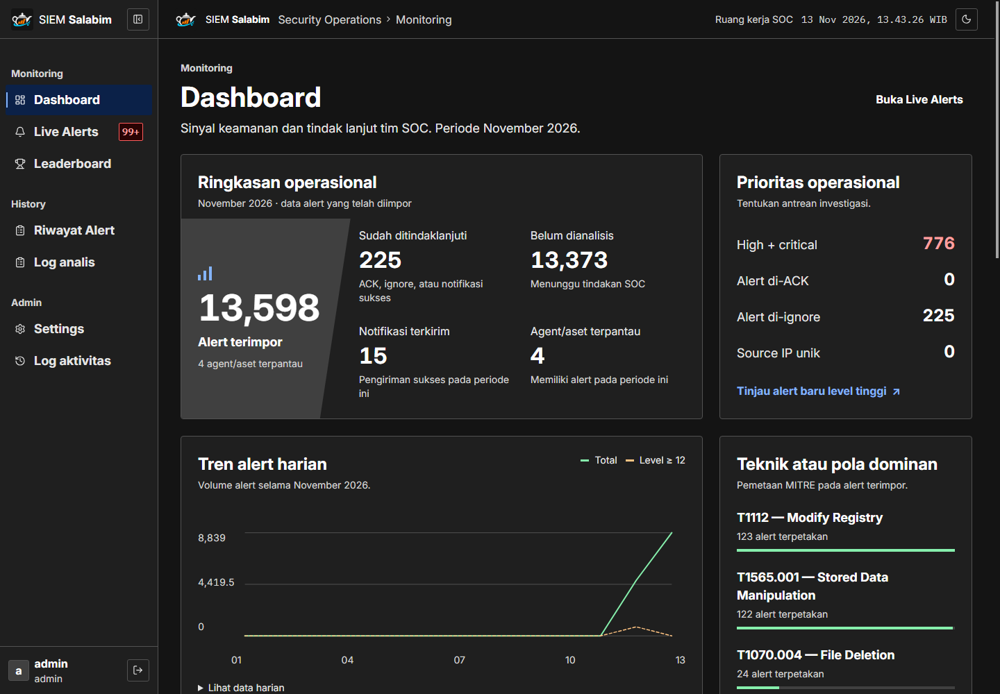

# SIEM Salabim

**Dashboard Wazuh dan OpenSearch untuk monitoring keamanan, investigasi, dan operasi SOC.**

[Dokumentasi lengkap](https://siem.sundaxploit.id) · [Instalasi](https://siem.sundaxploit.id/instalasi.html) · [Laporkan bug](https://github.com/SundaXploit/siem_salabim/issues)

## Tentang

SIEM Salabim adalah aplikasi **self-hosted** berbasis Laravel untuk membantu analis SOC dan tim CSIRT mengelola alert dari Wazuh Indexer/OpenSearch. Tim dapat memeriksa evidence, membagi penanganan, mencatat investigasi, dan mengomunikasikan temuan dari satu dashboard.

## Fitur utama

- **Monitoring alert:** dashboard, severity, filter, tren, dan konteks MITRE dari evidence.
- **Triage dan investigasi:** ACK, ignore dengan alasan, pemilik penanganan, dan kronologi alert.
- **Analisis AI:** dukungan provider cloud maupun lokal sebagai bahan pendukung investigasi.
- **Telegram:** template, notifikasi tunggal/massal, serta routing berdasarkan agent.
- **Akses tim:** role, privilege, cakupan agent, dan pengelolaan akun oleh admin.
- **Audit dan data:** log aktivitas, ekspor, backup JSON/SQL, dan retensi.

## Preview

[Lihat preview dan alur aplikasi →](https://siem.sundaxploit.id/#preview)

## Instalasi dan dokumentasi

**Panduan lengkap tersedia di [siem.sundaxploit.id](https://siem.sundaxploit.id).** Ikuti alur sesuai lingkungan agar runtime, izin file, database, dan proses latar belakang disiapkan dengan benar.

| Kebutuhan | Panduan |
| --- | --- |
| Komputer lokal | [Linux lokal](https://siem.sundaxploit.id/instalasi.html#linux-lokal) · [Windows / Laragon](https://siem.sundaxploit.id/instalasi.html#windows-lokal) |
| Server Linux | [Apache](https://siem.sundaxploit.id/instalasi.html#linux-apache) · [Nginx](https://siem.sundaxploit.id/instalasi.html#linux-nginx) |
| Hardening dan operasional | [HTTPS dan izin](https://siem.sundaxploit.id/instalasi.html#linux-hardening) · [Worker dan scheduler](https://siem.sundaxploit.id/instalasi.html#linux-worker) |
| Kendala instalasi | [File not found / permission](https://siem.sundaxploit.id/instalasi.html#linux-permissions) · [Token dan ownership runtime](https://siem.sundaxploit.id/instalasi.html#linux-installer-token) |
| Penggunaan dan perubahan | [Dokumentasi aplikasi](https://siem.sundaxploit.id/dokumentasi.html) · [Changelog](https://siem.sundaxploit.id/changelog.html) |

Persyaratan dasar: **PHP 8.3+**, **Composer 2**, **Node.js 22.12+**, npm, serta PostgreSQL/MySQL/MariaDB dengan database khusus aplikasi. Administrator pertama dibuat melalui wizard; tidak ada akun atau password bawaan. Worker dan scheduler diperlukan agar pekerjaan latar belakang berjalan.

## Keamanan

Pertahankan `APP_KEY` dan simpan backup konfigurasi secara privat. Gunakan HTTPS untuk operasional serta akun runtime yang sesuai saat menjalankan perintah server. Rincian akses, enkripsi, backup, dan batas perlindungan tersedia pada [panduan keamanan](https://siem.sundaxploit.id/dokumentasi.html#keamanan).

## Dukungan

Dikembangkan oleh [SundaXploit](https://github.com/SundaXploit) dan didukung oleh **[CSIRT – Diskominfo Subang](https://csirt.subang.go.id/profil)**.

## Kontribusi

Masukan, laporan bug, dan kontribusi kode/dokumentasi dapat diajukan melalui [Issues](https://github.com/SundaXploit/siem_salabim/issues) atau [Pull requests](https://github.com/SundaXploit/siem_salabim/pulls). Sertakan langkah reproduksi dan verifikasi yang relevan. Hindari menyertakan `.env`, token, password, atau data insiden sensitif pada laporan publik.

[Catatan teknis perubahan](docs/README.md) · [Kembali ke atas](#top)
